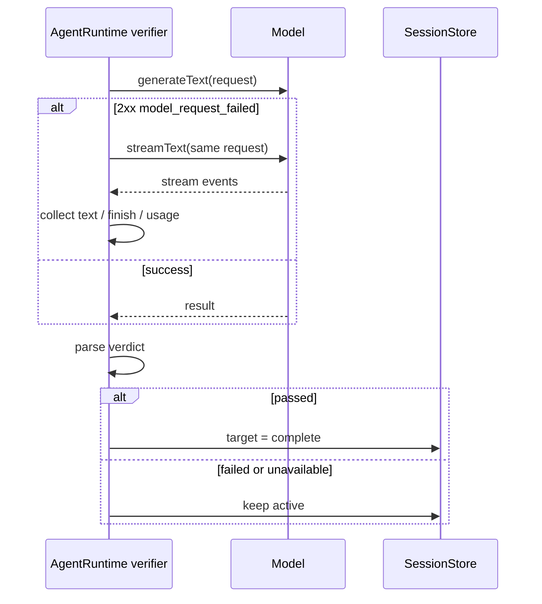

# 辅助模型请求传输回退与 Goal 失败语义

## 适用范围

本规范约束三类不承载主对话流的内部辅助请求：

- goal completion verifier；
- session title / goal summary title 生成；
- WebFetch 内容抽取。

三者共用同一个传输入口：先走非流式，命中“2xx 但正文不可解析”时在同一模型上改走流式。
WebSearch 原本就走流式，本次只复用同一流式结果收集器，不改变其传输语义。

## 背景

goal completion verifier 是 goal 自动续跑的唯一完成闸门。它在主 turn 结束后发起一次
辅助模型请求，读取完整会话历史并返回 `{ passed, reason, nextAction }`。

现有实现只走非流式 `generateText`。部分 openai-compatible 提供方对非流式请求返回
HTTP 200 + 解析失败（日志表现为 `model_request_failed` / `statusCode: 200` /
`Model request failed.`），而同一模型的流式请求正常。结果是 verifier 被判定为
基础设施失败，走 fail-open 直接把 target 置为 `complete`，表现为 goal 跑完一轮就停止。

## 产品规则

1. 非流式辅助请求失败且满足以下条件时，使用**完全相同**的 messages、tools、options
   和 abort signal，在同一模型上重试一次流式传输：
   - 错误码为 `model_request_failed`；
   - 错误上下文带有 `statusCode: 200`；
   - 请求未被取消。
2. 流式重试最多一次，不与 Start Plan busy 重试叠加成新的循环。Start Plan busy 仍按
   原有退避次数处理。
3. 流式重试成功后，按正常流程解析 verifier 文本并投影校验结果。
4. 两条传输都失败时，校验结果为 `passed: false` 且不带 `nextAction`：
   - 不得把 target 更新为 `complete`，不得发出“目标已完成”的投影；
   - target 保持 `active`，自动续跑循环结束，等待下一次触发（用户输入、后台任务通知、
     resume 或再次显式触发）；
   - 校验生命周期记录为 `failed_closed`，`reason` 包含真实错误信息，供日志和 UI 排查。
5. 用户 Stop / 队列抢占导致的取消不进入流式回退，继续沿用现有“暂停 target”语义。
6. verifier 成功返回但 JSON 格式非法时，保持现有 fail-open 行为；本规范只改变传输层
   失败与“成功响应但解析失败”的边界。
7. 不新增持久状态、定时器、轮询或额外重试队列。desktop `desktop-continuous` 与
   web `web-remote-replayable` 继续消费同一 lifecycle 事件，不改变传输边界。

## 状态所有者

- `AgentRuntime` 的 verifier 方法决定传输回退与校验结论。
- `session_target` 仍是 goal 状态唯一权威；只有 verifier 明确 `passed: true` 才能写入
  `complete`。
- 模型请求、重试与 usage 继续使用 verifier 启动时冻结的模型快照。

## 时序

## 验收

1. 非流式抛出 `model_request_failed` + `statusCode: 200`，流式返回合法通过结果时：
   target 变为 `complete`，只产生一次 verifier iteration。
2. 非流式与流式都失败时：target 保持 `active`，lifecycle 为 `failed_closed` 且
   `verification.passed === false`，不产生 `complete` 状态更新。
3. 请求被取消时不发起流式回退，target 按现有取消语义暂停。
4. 非 200 的普通失败不会触发流式回退，避免对鉴权、配置或网络错误重复发请求。
5. verifier 明确返回 `passed: false` 且带 `nextAction` 时，仍按现有逻辑继续下一轮。
