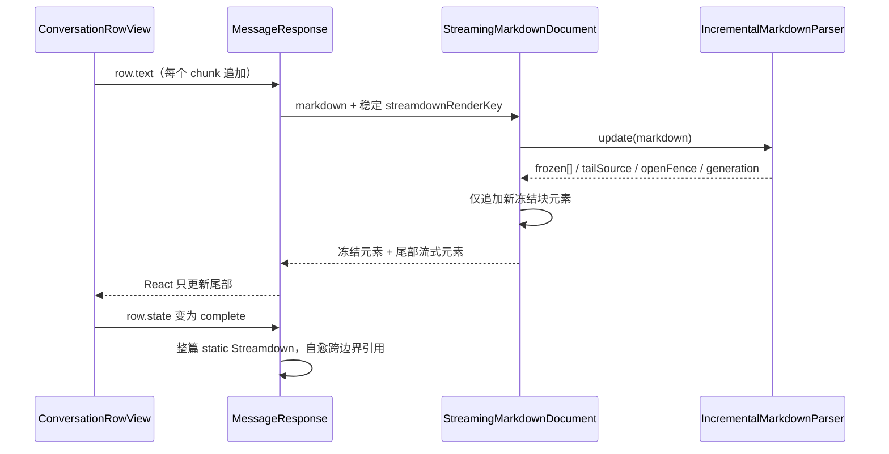

# 流式 Markdown 冻结前缀增量解析

## 产品规则

- 助手正文流式输出时，Markdown 只重新解析尾部不稳定区域；已经稳定的顶层块及其 React 元素保持复用，避免每个 chunk 重跑整篇文档的解析和高亮。
- 完成态（`streaming=false`）必须回到整篇文档一次性解析：引用式链接、脚注和跨边界结构由完成态整篇解析最终裁决。
- 冻结只影响解析与渲染成本，不改变最终 DOM 语义、搜索、复制、框选、代码块复制/换行按钮或主题。
- 冻结粒度是顶层块，不拆分单个段落、列表项、表格行或已闭合代码围栏。
- 未闭合代码围栏使用第二前沿：完整行进入稳定前缀，只有当前未完成行跟随 chunk 重新计算；围栏闭合后回到普通顶层块路径。
- 解析器输入必须是 append-only 的累计 Markdown 文本。文本不再以旧文本为前缀时视为替换，丢弃全部冻结块并递增 generation。

## 不变量

1. `frozen` 只增不减，且每个块的 `key` 等于该块在完整源文本中的绝对起始 offset；同一个块从尾部进入冻结区时 `key` 不变。
2. `frozen.map(source) + tailSource` 的拼接顺序与完整源文本一致；冻结块之间被丢弃的仅是无语义的块间空白。
3. `tailSource` 最多包含最后两个顶层块（含块间空白），加上未闭合代码围栏时只额外保留围栏的未完成行。
4. 同一 `text` 重复调用 `update` 必须幂等，返回同一个快照对象。
5. 一次追加只能影响解析前沿：前面已冻结的块不得因为后续 chunk 改变 `key` 或 `source`。
6. 解析器不得承担业务状态；它只接收文本、返回冻结块、尾部源文本和可选的未闭合围栏描述。

## 冻结边界

- 顶层块边界直接复用 Streamdown 的 `parseMarkdownIntoBlocks`：脚注、跨块 `$$` 数学公式和未闭合 HTML 会先被合并为一个块，冻结切点与渲染器一致。纯空白块不作为渲染块，跟随尾部或冻结前缀但不单独渲染。
- 保留最后 `UNSTABLE_TAIL_BLOCKS = 2` 个顶层块不稳定。追加文本可能把最后一段变成 setext 标题、表格或列表续行，第二块作为安全余量。
- 切点取第一个不稳定块的起始 offset，而不是最后一个冻结块的结束 offset，保证 `tailSource` 是完整源文本的逐字切片。
- 输入先做 CRLF/CR→LF 归一：Streamdown 的块划分同样归一 CRLF，不归一时 offset 无法与源文本对齐，且流式 chunk 拆开 CRLF 会误判为非追加输入。冻结块、尾部源文本和未闭合围栏代码均使用归一后的文本，Markdown 渲染语义不变。
- 以下情况不冻结新块：
  - 块划分结果不是完整文档（块长度和与输入不一致）；
  - 文档出现脚注引用、脚注定义或引用式链接定义（会反向影响冻结前缀，必须整篇渲染）。
- 上述情况返回 `fallback=true`；脚注和引用式链接定义会丢弃已有冻结块并递增 generation，块划分异常只影响本次冻结。已有冻结块是否保留由回退原因决定。

## 第二前沿（未闭合围栏）

- 当尾部最后一个顶层块是未闭合的 fenced code（``` 或 ~~~）时，解析器识别起始围栏、缩进、marker 长度、info string 和内容起点。
- 起始围栏行必须已经出现行结束符才进入第二前沿；` ``` `、` ```ts ` 这类还在追加语言标识的片段继续走普通尾部渲染，避免把 info string 误当成代码内容。
- 内容按行切分：最后一个换行符之前的完整行进入稳定值，当前未完成行留在 pending；每个 chunk 只重新计算 pending 行并追加到稳定值。
- 围栏闭合后，下一次更新回到普通块解析，代码块按顶层块重新参与冻结计数。
- 缩进围栏按 CommonMark 规则最多剥离围栏缩进宽度；CRLF 与单独的 CR 按一个行结束处理。
- 未闭合围栏的内容仍然交给同一个代码块组件渲染，保持代码块头部、复制、换行和语言展示一致；不在围栏内容上启用语法高亮或 Mermaid（与现有流式行为一致）。

## 渲染缓存

- 流式正文按冻结块缓存 React 元素：元素 key 为 `frozen-<绝对 offset>`，`frozen` 增长时只追加快照中新增的块。
- 尾部使用稳定 key 的流式容器，每个 chunk 只重新渲染尾部源文本。
- 未闭合围栏使用围栏起始 offset 作为代码块 key，只更新 `code`，不重新挂载代码块。
- 冻结元素缓存的生命周期绑定到消息渲染实例，并通过 `streamdownRenderKey` 失效：主题、代码预览设置、workspace、session、attachment reader、citation 开关或强制换行变化时必须丢弃旧元素，避免缓存闭包内保留旧主题或旧 reader。
- `labels`、图片/附件解析器、主题和代码设置由调用方保持引用稳定；渲染器不得在 chunk 之间重新创建这些闭包。

## 失效与回退

| 触发                                     | 行为                                                    |
| ---------------------------------------- | ------------------------------------------------------- |
| 文本是旧文本的前缀追加                   | 保留冻结块，继续尾部增量解析                            |
| 文本不以旧文本为前缀（编辑、替换、重放） | 清空冻结块，`generation + 1`                            |
| 块划分异常或块偏移不完整                 | 本次不冻结，返回 `fallback=true`                        |
| 出现引用式链接定义、脚注引用或脚注定义   | 丢弃冻结块并 `generation + 1`，整篇尾部渲染             |
| 跨块 `$$`、未闭合顶层 HTML               | 块划分先合并，合并块停留在尾部，不冻结                  |
| 围栏闭合或出现闭合围栏候选               | 退出第二前沿，下一次按普通块解析                        |
| 主题/代码设置/workspace/reader 变化      | 渲染实例整体重建，旧元素全部丢弃                        |
| 消息完成                                 | 不走增量缓存，整篇 `mode="static"` 解析并自愈跨边界引用 |

## 所有者

- `packages/ui/src/lib/incrementalMarkdown.ts`：纯解析器，拥有冻结块、尾部源文本、未闭合围栏状态和 generation。
- `packages/ui/src/components/ai-elements/streamingMarkdownDocument.tsx`：React 元素缓存与追加策略，拥有冻结元素数组。
- `MessageResponse`：拥有渲染实例生命周期和 `streamdownRenderKey`，决定流式增量或完成态整篇渲染。
- CLI/runtime 与会话投影仍是正文事实的唯一所有者；增量解析不持久化、不回写消息。



## 验收

1. 追加式文本连续更新时，冻结块数量单调增加，`key` 等于绝对 offset，重复输入返回同一快照。
2. 块从尾部跨过冻结边界时保持原 `key` 和 `source`，后续追加不改变已冻结内容。
3. 未闭合围栏只重算 pending 行，完整行不重复解析；围栏闭合后该代码块可正常进入冻结区。
4. 非前缀替换递增 generation 并清空冻结块；块划分异常、偏移不完整、引用式链接定义或脚注返回 `fallback=true` 且不产生错误 DOM。
5. 流式消息的搜索、复制、框选、代码块复制/换行按钮与完成态一致；完成态引用式链接和脚注正常。
6. 桌面与手机 Web 共用同一解析器；窄屏、主题切换和中英文正文不出现重复渲染或元素丢失。
7. 浏览器交互（滚动、框选、复制、主题切换）必须在真实客户端复核；本 spec 的验收以解析器单测和类型/Lint/架构检查为基础，不等同于跨平台视觉验收。

## 边界

- 单条超长 Markdown 在工作项内部按顶层块增量解析，但仍受虚拟窗口和单轮挂载成本约束；不会把一条消息拆成多个会话行。
- 流式期间出现引用式链接定义或脚注时回退为整篇尾部渲染，不保留冻结前缀；跨块公式和未闭合 HTML 由块划分合并为尾部块，不会跨冻结边界。
- 增量解析不改变 Streamdown 的插件、安全过滤、图片/附件解析或外链分流；这些行为仍由现有渲染器和调用方负责。
- 不在本变更中修改 `ConversationTimeline`、滚动锚定、工具搜索、工作流、MCP Apps 或 runtime。
