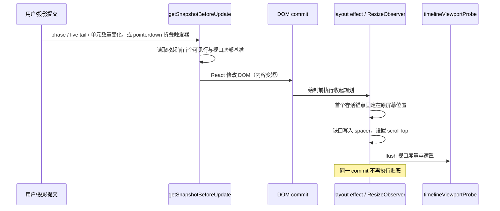
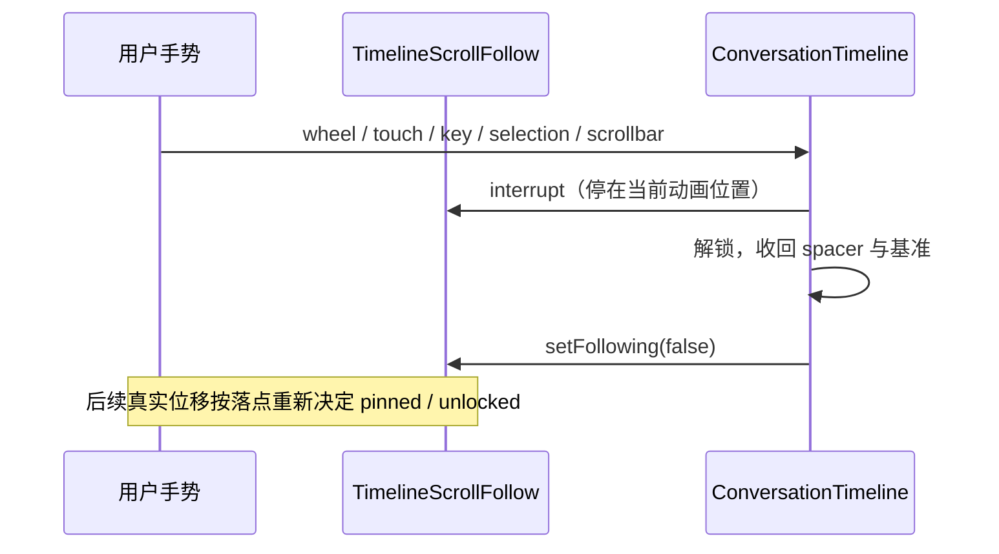

# 长会话滚动锚定与跟随

## 背景与目标

长会话里最刺眼的跳位不来自新消息追加，而来自「内容在阅读位置上方一次性变短」：

- 轮次完成时工作历史自动折叠（Radix Collapsible 高度动画）。
- running 轮次从 normal-flow live tail 迁移进虚拟历史。
- virtualizer 分批修正测高，把总高度往下修。

这三类变化都会让内容尾部上移。浏览器为保持 scrollTop 合法会向下钳制滚动位置，用户正在看的正文随之整体滑动。本规范用「下方留白 + 首个可见行锚定」抵消这类收起，并把「跟随底部 / 阅读历史 / 跳转在途」收敛为单一显式状态机。

目标：

- 贴底阅读时，轮次完成、工作历史折叠、live tail 迁移、虚拟测高变短，视口内正文位置不跳。
- 用户手势立即接管滚动权；原生平滑跟随只在 pinned 下发生，且动画中间帧不被误判为阅读移动。
- 显式回到底部、恢复、跳转、解锁、宽度变化、行清空后不留残留空白。
- 不改变 `totalSize`、`scrollMargin`、虚拟列表测量契约，不引入逐行 observer 或逐帧 React 状态。

## 所有者与接口

| 关注点                     | 唯一所有者                                          | 说明                                                                 |
| -------------------------- | --------------------------------------------------- | -------------------------------------------------------------------- |
| 跟随意图与原生平滑动画目标 | `TimelineScrollFollow`（`timelineScrollFollow.ts`） | pinned / unlocked / jumping 的布尔投影；动画目标只在这里取消或重定向 |
| 收起前阅读基准             | `ConversationTimeline` 的 `closingBaselineRef`      | 只在 pinned、空闲、非跳转、非宽度重排时捕获                          |
| 下方留白高度               | `closingSpacerRef` 指向的 DOM 元素                  | 只通过 ref 命令式写 `style.height`，不进入 React state               |
| 收起几何计算               | `timelineClosingAnchor.ts`（纯函数）                | 捕获基准、规划 spacer/scrollTop、增长抵扣、TTL 判定                  |
| 虚拟列表几何               | 现有 `useVirtualizer`                               | spacer 位于虚拟历史之外，`totalSize`/`scrollMargin` 不变             |
| 视口度量与遮罩             | 现有 `timelineViewportProbe`                        | 收起写入后调用 `flush()`，不新增订阅路径                             |

`following` 仍是滚动权的唯一事实；`scrollOwnership` 是它的三态投影：

- `pinned`：贴底，内容增长自动跟随；
- `unlocked`：用户读历史，流式增长不得改变阅读位置；
- `jumping`：程序化跳转在途，期间不显示新消息计数，结束后落到 `unlocked` 或 `pinned`。

现有 `loadOlder` prepend 锚定、查找/目录跳转、live tail 拆分、手机 Web 布局与 reduced-motion 均保持原路径。

## 事件顺序

### 收起保持（终态、折叠、测高）

规则：

1. 基准的 `fromEnd` 以「捕获时视口底部所在的内容坐标」为准，而不是内容末尾；贴底容差内的偏移不会在收起后放大成跳位。
2. 锚点粒度是行（`data-row-id`），不是整轮：整段工作历史收起时，用 5000 项 live tail 的顶部做锚点会把顶部留在视口外；行级锚点可回退到未被收起的回答或工具行。
3. 首个可见行消失时，按「其后仍在屏幕内的行 → 更上方一屏内的行」回退；全部消失则本轮不锚定（`lost`），但不能立即清掉基准，后续绘制前的 ResizeObserver 仍会重试。
4. spacer 最多占半个视口；超过时内容尾部停在视口中线，避免最后一条消息被顶出阅读区。
5. 内容尚未变短时保持基准（`hold`），本 commit 不贴底；由 ResizeObserver 在后续动画帧继续尝试；基准 1 秒后过期。
6. 内容反而增长时丢弃基准（`grow`）并恢复常规贴底，避免拿过期屏幕坐标保持阅读位置。
7. 采样器持有视口期间（基准存在或 spacer > 0），禁止 tanstack 逐条尺寸补偿，最终位置只写一次，避免先补偿再覆盖的闪动。
8. 贴底状态下内容继续增长时，新增高度先抵扣 spacer；spacer 填满后才恢复常规贴底。若后续测高继续变短，留白同步撑高，防止 scrollTop 被向下钳制。

### 阅读手势与平滑跟随

规则：

1. 只有调用时已 pinned 且距底不超过两个视口的显式「回到底部」允许一次原生 smooth；超长距离、非 pinned 与 reduced-motion 一律 instant，避免长动画被虚拟测高的内容 commit 逐次重启而到不了终点。
2. smooth 的中间帧只更新几何账目与遮罩，不改变跟随意图；`scrollend` 或 600ms 兜底计时器统一落账。
3. 动画未到达目标附近视为用户接管，解除跟随。
4. 动画在途时内容再次变化（测高/流式增长）取消动画并按最新地板立即落位，保证最终仍贴底。
5. 跳转设置 400ms 兜底：目标已在原位时不派发 scroll，所有权不能永久停在 `jumping`。

### 重置时机

以下动作必须立即把 spacer 高度写回 `0` 并丢弃基准：

- 显式回到底部（按钮、宿主 `scrollToBottomActionRef`）；
- 会话恢复 / scope 切换；
- 查找、目录、引用定位等程序化跳转；
- 用户解锁（上滚、拖选、键盘、拖滚动条）；
- 内容列宽度变化（旧宽度的锚点几何失效）；
- 行清空（rewind 等大范围裁剪）。

## 验收

1. 合成数据下，贴底完成一个含 5000 工作项的轮次：工作历史折叠与 live tail 迁移后，首个存活行（回答行）的屏幕位置变化小于 8px（本地实测两个视口均为 4px），且未出现空白残留。
2. 展开/收起工作历史、分批测高、header 高度变化后，阅读位置不跳；spacer 在绘制前写入，不产生闪动。
3. 距离底部 1–48px 时收起，不出现额外上跳（`fromEnd` 以视口底部为基准）。
4. 用户上滚、拖选、键盘翻页立即解锁并收回 spacer；流式增长不改变阅读位置。
5. 回到底部在 reduced-motion 下立即落底；普通模式下 smooth 期间中间帧不被计为用户滚动，`scrollend` 后为 pinned。
6. 查找/目录跳转后所有权不会停在 `jumping`；无 scroll 事件时由兜底计时器结束。
7. prepend 历史、live tail 流式输出、手机窄屏布局与现有浏览器回归脚本行为不变。
8. `pnpm exec tsc --noEmit -p packages/ui/tsconfig.json`、定向 oxlint、`pnpm architecture:check --changed` 与 `git diff --check` 通过。

## 验证记录

2026-10-29 本机 Windows、Edge headless、Vite fixture（5,797 行 / 5,000 段工作正文）：

- `pnpm typecheck`、`pnpm exec tsc --noEmit -p packages/ui/test/tsconfig.long-conversation.json` 通过。
- `timelineClosingAnchor`、`timelineScrollFollow`、`timelineScrollAnchor`、`timelineViewportProbe` 共 42 个 Node 测试通过。
- `run-regressions.mjs` 在 1258×622 与 390×844 均通过 `measureScrolling`、`verifyWorkWindow`、`verifySessionSwitch`、`verifyInteractions`；滚动 P95 约 19–31ms，无超过 50ms 的样本。
- 额外合成测量：贴底完成 5,000 工作项轮次后，唯一存活的回答行在两个视口均移动 4px；结束时 `distanceToBottom=0`、所有权为 `pinned`。
- `pnpm architecture:check --changed`、定向 oxlint、`git diff --check` 通过；全仓 lint 仍有 1 个既有 `max-lines` 错误（`packages/services/src/setting/settingService.ts`，未修改）。

## 边界与未验证

- 浏览器运行时回归依赖本机浏览器与 Vite fixture；本次已执行上述脚本，但未覆盖 macOS/Linux、真实手机、Electron 原生窗口与真实多年会话。
- 收起基准覆盖「running 轮结束 / live tail 迁移」与折叠触发器的 pointer/key 捕获；手工 Radix 折叠的 pinned 路径与完成态走同一行级规划与 ResizeObserver，但没有单独的运行时断言。没有结构变化的极小测高收缩依赖已存在的基准，超出 1 秒有效期后不再锚定。
- 内容收起后若总高度已短于视口，浏览器无法通过底部留白把锚点保持在原屏幕位置；此时按半屏上限接受位移。
- 单条超高行、真实多年会话仍需独立验证；不新增持久化、协议字段或跨进程状态，Desktop continuous 与 Web replayable 的恢复语义不变。
