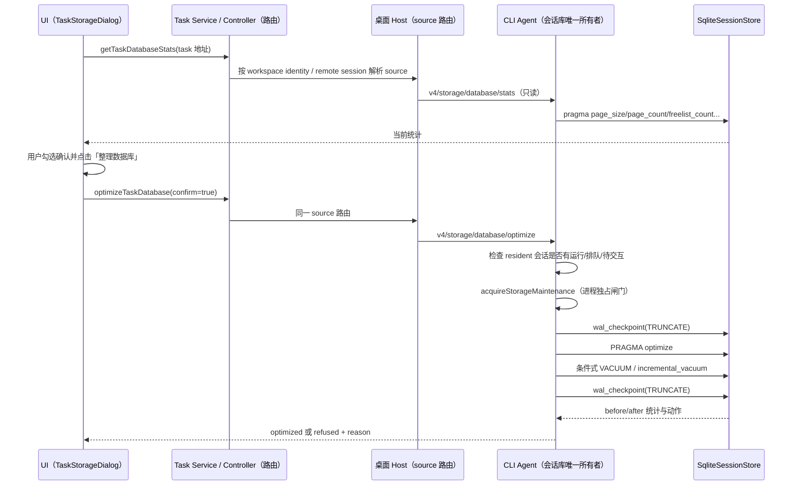

# 会话数据库显式整理

## 产品规则

- 会话数据库（`~/.ycode/cli/db/db.sqlite`）是全应用共享的一份 SQLite 文件。用户必须在「存储与永久删除」弹窗中显式查看统计并点击整理；启动、删除会话、永久删除、归档、清理日志都不会自动触发 VACUUM。
- 弹窗展示数据库文件字节、`page_size`、`page_count`、`freelist_count`、`freelist_bytes`、`auto_vacuum`、`journal_mode` 与 WAL 字节。统计只读，不打开第二个数据库连接。
- 用户确认后按固定顺序执行：WAL `wal_checkpoint(TRUNCATE)` 预检 → `PRAGMA optimize` → 仅在满足条件时 `VACUUM` 或 `PRAGMA incremental_vacuum` → 再次 `wal_checkpoint(TRUNCATE)`。任何一步失败都返回失败或拒绝，不伪报成功。
- VACUUM 只在 `auto_vacuum = 0` 且 `freelist_count >= 64` 且 `freelist_bytes >= max(1 MiB, 5% 数据库文件)` 时执行；否则只执行 `PRAGMA optimize`，返回 `action = optimize-only`、`reason = freelist-low`。`auto_vacuum = 2` 且 freelist 非空时执行 `incremental_vacuum`；`auto_vacuum = 1` 不执行 VACUUM。
- 整理不删除任何会话、消息或文件，也不改变永久删除语义。永久删除只释放可复用页；统计中的 freelist 变化如实展示，不把一次删除变成全库 VACUUM。
- 拒绝原因必须明确：`sessions-active`（有运行中/排队中/等待交互的会话）、`database-busy`（WAL checkpoint 或 VACUUM 拿不到锁）、`insufficient-disk-space`（可用空间小于当前数据库文件，VACUUM 约需 2 倍峰值）。拒绝时不取消、不停止、不重启任何会话。
- `reclaimed_bytes = max(0, before.databaseBytes - after.databaseBytes)`；同时返回 before/after 全量统计，UI 同时展示两者，不用单一数字掩盖未缩小的事实。
- 入口固定为任务级「存储与永久删除」弹窗中的数据库区块；入口存在于任意会话，但整理对象始终是该 Agent 所属的共享会话库，不是单个会话、不是第二个数据库。UI 不直接访问 SQLite 或文件系统。

## 所有者与事件顺序

- 唯一写入方是 CLI Agent 进程持有的 `SqliteSessionStore`；Host/Main/Renderer 不读也不写数据库。
- 协议方法为 additive：`v4/storage/database/stats` 与 `v4/storage/database/optimize`。统计方法走普通请求租约；整理方法像永久删除一样不取得普通请求租约，改用 `SessionResidentPool.acquireStorageMaintenance()`，确保没有并发请求在同一进程内交错。
- 整理期间新到请求快速失败（`session_storage_busy`），而不是等待 SQLite 锁；整理结束后恢复。
- 跨进程并发（另一个 workspace 的 Agent）由 SQLite 锁兜底：checkpoint busy 或 VACUUM busy 都转换为 `database-busy` 拒绝，不强杀进程。
- `node:sqlite` 是同步 API。整理只在没有运行中会话时执行；VACUUM 期间进程内请求快速失败，不依赖超时掩盖同步等待。

## 安全与边界

- `PRAGMA busy_timeout` 只在一次同步维护调用内临时缩短（250ms），调用结束立即恢复，避免长时间独占事件循环；不在 `await` 之间修改连接级 PRAGMA。
- 磁盘空间检查使用 `fs.statfs`；探测失败时不阻止操作，但也绝不把 VACUUM 异常吞掉。SQLITE_FULL 等错误直接向上抛出，UI 显示失败。
- 统计中的 `databaseBytes` 来自文件 `stat`，`walBytes` 来自 `-wal` 文件；页面字节来自 PRAGMA。文件与 PRAGMA 之间允许存在并发写入的微小偏差，UI 不把它解释成删除成功。
- 远程 workspace 由远程 Agent 整理其自己的会话库；本地 UI 不跨机访问文件。
- 数据库整理不写任何业务表，不修改会话状态、标题、归档或删除墓碑。

## 验收

1. 临时目录中的 SQLite 库删除大量行后 `freelist_count` 增加；统计报告文件字节、页数与 freelist。
2. 满足阈值时整理返回 `action = vacuum`，`after.databaseBytes <= before.databaseBytes`，`after.freelistCount` 降低；数据行数不变。
3. freelist 低于阈值时返回 `action = optimize-only`、`reason = freelist-low`，不执行 VACUUM，文件字节基本不变。
4. 另一连接持有读事务时 `wal_checkpoint(TRUNCATE)` 返回 busy，整理返回 `refused` + `database-busy`，不抛错、不损坏数据库。
5. 有运行中/排队/待交互会话时协议层返回 `refused` + `sessions-active`，不停止会话、不执行任何 PRAGMA 写操作。
6. 永久删除成功后不自动整理；永久删除结果仍只报告逻辑回收与 freelist。
7. 类型检查、定向 lint、架构检查与 `git diff --check` 通过；真实用户历史数据不在验证中使用。

## 交付与验证（2026-10-29）

- 入口：既有「存储与永久删除」弹窗内的「会话数据库」区块；只有勾选确认并点击「整理数据库」才执行。
- 协议：`v4/storage/database/stats`、`v4/storage/database/optimize`；CLI 使用 `SessionResidentPool.hasActiveWork()` 与 `acquireStorageMaintenance()`，Store 实现在 `session-database-maintenance.ts`。
- 隔离 SQLite 测试 4 项通过：freelist 统计、超过阈值触发 VACUUM 且行不变、低 freelist 跳过 VACUUM、并发读者拒绝为 `database-busy`。Protocol 测试 3 项通过：活动会话拒绝、进程租约冲突拒绝、维护后闸门释放。
- 浏览器覆盖 1100/390/260px、永久删除回归、显式整理确认与 before/after；`run-task-storage.mjs` 与 `run-task-delete-entry.mjs` 通过。
- 根 `pnpm typecheck`、CLI `pnpm --dir apps/ycode-cli typecheck`、`pnpm architecture:check --changed` 通过；根 `pnpm lint` 仅有既有的 `settingService.ts` max-lines 错误与 53 个既有警告；CLI 定向 lint 的超长文件错误均来自既有文件。
- 未在 macOS/Linux 实机验证；未对真实用户数据库执行 VACUUM。
