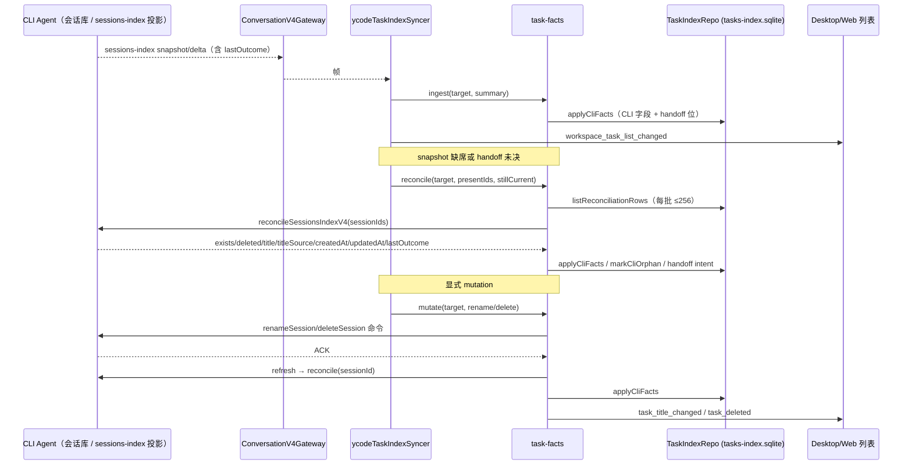

# Task facts 与 sessions-index 摄入

## 产品规则

- sessions-index 的会话行由 CLI 持久事实驱动，不由 Host 时钟或运行态推导。标题、`titleSource`、`createdAt`、`updatedAt`、`lastOutcome` 与删除标记的唯一所有者是 CLI 会话库；Host 只把已通过协议校验的摘要投影到 `tasks-index.sqlite`。
- sessions-index snapshot 缺席不等于删除。冷启动、断档恢复或 handoff 后，Host 只对“快照缺席”或“仍有旧版本交接意图”的行按明确 sessionId 回查 CLI；不存在/查不到时标记 orphan 并保留行，只有 CLI 明确返回删除或收到 `session.removed` delta 才隐藏。
- 显式重命名/删除走 `task-facts.mutate`：先执行 CLI 命令并确认 ACK，再回查持久事实；失败直接抛出，不乐观写 SQLite，也不另建重试队列。
- 旧版本交接只用 `handoff_pending` bit 表达：1=删除意图，2=标题意图，4=orphan，8=归属已判断。确认后由存储事务清位；Host 不根据列表缺席推断删除。
- `lastOutcome` 是 CLI 事实：`completed`/`interrupted` 投影为可见完成，`error` 投影为错误。摘要缺少 `lastOutcome` 时不得制造终态，保留既有状态。
- 热路径保持 `sessions-index-fanout-throttle` 的 leading + trailing 语义：工作流进度等高频事件合并为窗末一帧，终态仍在一个窗口内送达；本切片不新增逐事件全量索引写。

## 所有者与事件顺序

- `task-facts` 是无 SQLite、无计时器、无第二份状态缓存的 app 层端口：存储、CLI 来源与广播通过参数注入。
- 每个 `await` 后核对订阅代际/水位（`stillCurrent`）；迟到结果不能覆盖新帧。refresh 使用代际 Symbol，新帧到达即撤销旧请求的落库资格。
- desktop continuous 与 mobile replayable 共用同一 CLI owner；协议传输、READY、CommandInbox FIFO/去重仍归原协议层。
- 组织态（pin/archive/read/项目归属）仍归 Host 产品壳；task facts 只写 CLI 事实列与 handoff 位，不回写这些字段。

## 持久化与迁移边界

- `tasks-index.sqlite` 新增 additive 列：`cli_title`、`cli_title_source`、`cli_created_at`、`cli_updated_at`、`cli_last_outcome`、`cli_deleted`、`handoff_pending`（默认 0）。
- 迁移 `0005_task_facts_columns` 在事务内逐列 `PRAGMA table_info` 检查后 `ALTER TABLE ADD COLUMN`，重复执行安全；只回填空值，不重写正文、组织态或已有 CLI 事实。
- 旧行的 `deleted`/`title_overridden` 只转化为 handoff 位，由 reconcile 回查 CLI 确认后收口；不直接删除会话正文。
- CLI 会话表新增 additive `last_outcome`/`time_deleted` 列；`TurnComplete`/`TurnError` 在事件发布前持久化结果，`deleteSession` 先软删除再关闭运行实例。恢复会话时回填到 Host record，冷种子/reconcile 直接读取。
- 不引入 project-first/source-server、远程项目或 UI 项目侧栏。

## 失败与降级

- CLI 不支持 `v4/sessionsIndex/reconcile` 时，syncer 跳过回查并保留已有行与 handoff 意图；不把“能力缺失”解释为删除。
- reconcile 单批失败只记 `warn`，下一帧/下次订阅继续对账；已提交的批不重复撤销。
- CLI 命令 ACK 失败时 mutation 抛出，SQLite 保持上一个已确认事实。
- orphan 行保持可见性由既有产品壳决定；未被明确删除时不隐藏。

## 验收

1. 首帧 snapshot 为大量历史会话补齐行，且不广播历史终态；每行写入 CLI 标题、时间与 `lastOutcome`。
2. 删除 delta 写 CLI 删除事实；snapshot 中缺少某会话但 CLI 仍存在时保留行并写入最新标题/时间。
3. CLI 不存在该会话时标记 orphan（bit 4），不删除行。
4. 带标题 handoff（bit 2）的行回查 CLI 后执行 `renameSession`，确认后清位并落库。
5. 带删除 handoff（bit 1）的行回查 CLI 后执行 `deleteSession`，确认后清位并隐藏。
6. `lastOutcome=error` 投影为错误；`interrupted` 与 `completed` 投影为完成；缺失 `lastOutcome` 不改写既有终态。
7. 高频工作流进度仍经过 fan-out throttle，不产生逐事件索引风暴。
8. 迁移在已有库和新库上均可重复运行，列只增不减；`git diff --check` 无空白错误。

## 交付边界（本切片）

- 已包含：task-facts contract/index/module、`repairSubagentTaskIndex`、TaskIndexRepo CLI 事实存储、syncer 摄入/对账、shared sessions-index `lastOutcome` 与 reconcile schema、Gateway/Bridge/Server/Agent 的 `reconcileSessionsIndexV4`、CLI `last_outcome`/`time_deleted` 持久化。
- 未包含：project-first/source-server、远程项目、项目侧栏、按项目归属迁移。
