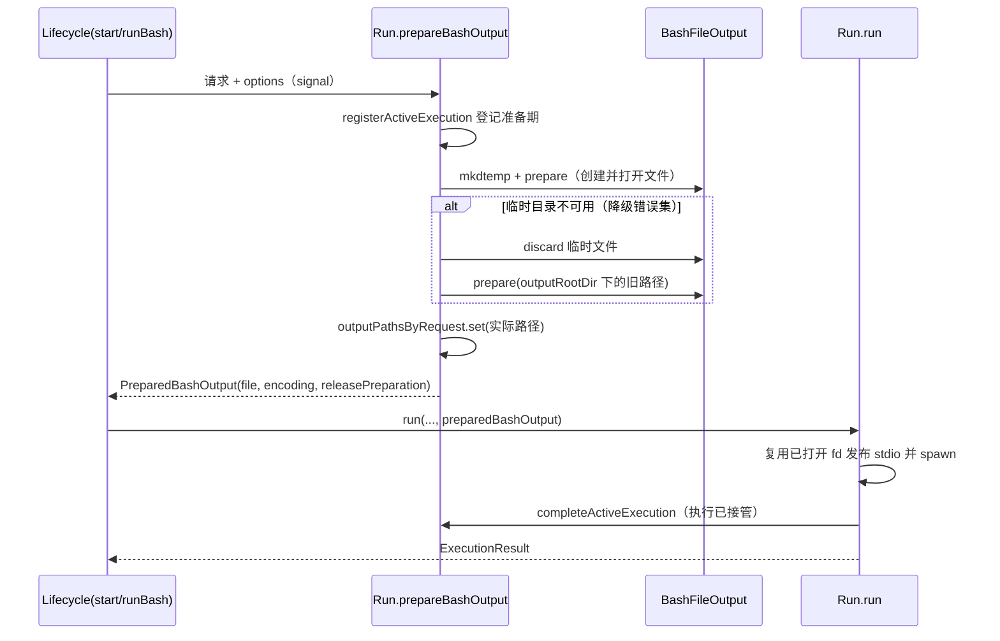

# Bash 输出临时目录隔离

## 背景

Bash 直写输出文件后，内嵌搜索（embedded search）会递归搜索数据目录。若输出文件位于数据根
目录内，搜索进程会读到正在写入的命令输出，并把命中结果再写回同一个文件，形成自引用，既污染
搜索结果，也让输出体积异常增长。

本规范将 Bash 合并输出（`command.mode === "shell"` 且 `shellProfile === "posix-bash"`）的
默认落盘位置隔离到系统临时目录，并保留到原有 `outputRootDir` 的完整降级路径。

## 目标

- Bash 合并输出默认创建在 `<os.tmpdir()>/ycode-bash-<随机标识>/<session>/<tool>-stdout.log`。
- 临时目录不可用时完整降级到原有 `<storageRoot>/cli/exec` 实现，不改变文件语义。
- 输出路径在 spawn 之前确定并发布，spawn 之后不再切换路径、不重新打开文件。
- 非 Bash 请求与非合并输出路径完全不变。

## 非目标

- 不清理历史遗留的临时输出目录，不扫描旧布局。
- 不修改内嵌搜索外壳、shell 初始化快照、启动脚本或 watchdog 行为。
- 不把临时输出纳入 App 存储占用统计、退出归档或批量清理。
- 不改变既有输出预算（5 GiB 硬上限、5 秒进度阈值）和前后台保留规则。
- 不使用超时或静默重试掩盖创建失败。

## 路径与注入

| 项目           | 说明                                                                                         |
| -------------- | -------------------------------------------------------------------------------------------- |
| 临时父目录选项 | `NodeExecutionAdapterOptions.bashOutputTempDir`，可选；未注入时保持原有行为                  |
| 注入位置       | `create-app.ts`、`script-workflow-child-runtime.ts`、`workflow-facade.ts` 注入 `os.tmpdir()` |
| 临时根         | 每个 adapter 按需异步 `mkdtemp(join(bashOutputTempDir, "ycode-bash-"))`，成功后缓存复用      |
| 输出文件       | `<临时根>/<session>/<toolCallId>-stdout.log`，stdout 与 stderr 直写同一 fd                   |
| 降级根         | `outputRootDir ?? resolveDefaultOutputRootDir(processEnv)`，即原有 `<storageRoot>/cli/exec`  |

临时根创建失败时清除缓存，下一次请求重新尝试；成功结果在 adapter 生命周期内复用。临时父目录
必须已存在，不通过 `mkdir` 自行创建系统临时根。

## 状态所有权与时序

`NodeExecutionAdapterRun` 是输出路径的唯一所有者；`NodeExecutionAdapterLifecycle` 只负责在
启动子进程前调用准备逻辑并把结果移交执行链路。

- 准备阶段登记为 active execution，adapter `close()` 会将准备标记为停止并等待其结算。
- 路径在后台任务记录、`outputPathsByRequest` 和文件对象三处发布后才允许 spawn。
- `PreparedBashOutput` 携带实际文件对象、已解析的输出编码和 `releasePreparation`；
  执行接管后释放准备记录，保证同一时刻只有一个 owner。
- 生命周期一次性解析输出编码，任务记录复用该值，避免重复执行 Windows `chcp`。

## 降级规则

仅临时准备阶段的以下错误码允许降级：

`EACCES`、`EPERM`、`EROFS`、`ENOENT`、`ENOTDIR`、`ENOSPC`、`EDQUOT`

降级流程先丢弃临时文件，再以 `BashFileOutput` 重新在旧根目录下创建并打开输出文件。其他错误
以及降级阶段自身的失败沿现有失败链路返回 `spawn_error`，不吞错。

必须实际创建并打开文件，不能用 `access` 预检查代替。降级后的路径始终由 `outputRootDir`
（或默认根）与已缓存的 session/tool 文件名派生，避免请求复用时把临时路径误写入降级根。

## 取消与关闭

- 准备期间取消（`signal.aborted`）或 adapter 关闭时，释放本次文件句柄并按需删除本次创建的
  文件，返回 `cancelled`（"Execution cancelled before spawn"），不启动子进程。
- 命令启动前的第二次停止检查发生在命令准备与输出准备之后；此时丢弃已准备文件并返回停止结果。
- 后台任务在准备失败时仍生成一条终态记录（`cancelled` 或 `spawn_error`），保持记录可查询。

## 清理

- 沿用既有规则：前台小输出与超限文件 best-effort 删除；大输出和后台文件保留。
- 临时输出不随 adapter 关闭删除或归档，接受系统临时目录清理；进程退出后不保证可读。
- 删除失败不影响主结果，也不删除原有文件（`BashFileOutput.discard` 仅在本次创建时删除）。

## 验收

1. 注入 `bashOutputTempDir` 后，Bash 合并输出文件实际路径位于
   `<os.tmpdir()>/ycode-bash-*/<session>/`，`stdout` 与 `stderr` 写入同一文件。
2. 后台任务快照、`readBackgroundBashOutput` 与保留 artifact 时的执行结果路径均指向该临时路径。
3. 临时父目录不可写（或不存在、非目录、只读、空间不足等降级错误）时，文件回落到
   `<storageRoot>/cli/exec/<session>/`，命令结果与前台/后台语义不变。
4. 非降级错误（如权限以外未列出的错误码）不触发降级，按 `spawn_error` 返回。
5. 准备期间取消或关闭 adapter 时不 spawn 子进程，不残留本次创建的文件。
6. 未注入 `bashOutputTempDir` 的 adapter 与非 Bash/非合并输出请求的路径、日志和清理行为与改动前一致。
7. 内嵌搜索不再读到本命令自身正在写入的输出文件（降级路径除外）。

## 未验证

- 未在本轮执行端到端内嵌搜索回归；验收第 7 条需在真实任务中验证。
- 系统临时目录被外部清理后，运行中的后台任务读取会走既有 `read_failed` 链路，本轮未额外测试。
