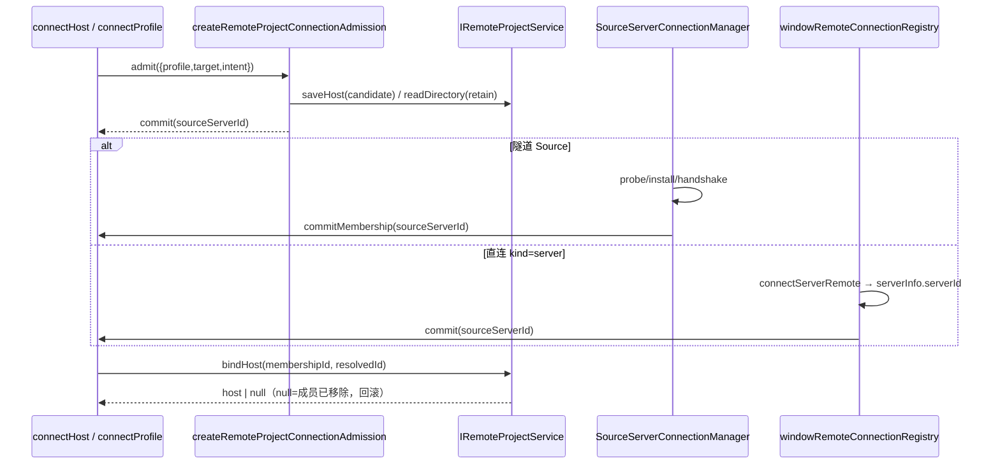
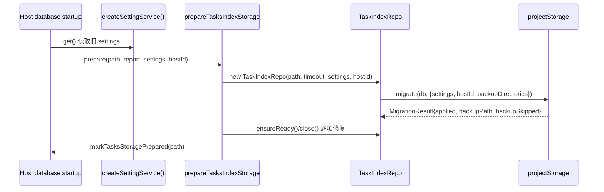

# 项目服务层（Project Service / Remote Project Service）

本切片在已移植的 `project-storage`、`project-catalog` 与 Source Server 后端之上，补齐 Host 侧项目服务与远端项目入口服务。不包含项目侧栏、设置页设备卡或任何 UI。

## 产品语义

- **项目组织态的唯一所有者**是当前持库 Host 的 `tasks-index.sqlite`。`IProjectService` 只做真实目录校验、默认目录创建、主目录可用性投影与仓储事务调用；`IRemoteProjectService` 只管理本机持有的远端入口（`hosts` + `remote_project_entries`），不复制远端任务或会话。
- **workspace identity vs path**：`workspaceIdentity` 用于去重、绑定、缓存、队列与请求关联；`workspacePath` 用于文件操作、命令 cwd、Git 与展示。跨 host 的返回目录必须经既有 identity resolver 解析，禁止在业务层按路径推断设备。
- **primary root**：项目允许 0..n roots，但自动归档、准备会话与远端单 root 约束都以 `isPrimary` 为准；不得用数组首项替代。
- **virtual project / legacy single root**：握手缺少 `virtualProjects` 的旧 Host 只通过 `createLegacySingleRootProjectService` 提供只读投影；合成 ID 稳定但不落库，组织写操作显式 `project.legacy-read-only`。
- **owner/lease**：每个项目行按 `host_id` 归属；`ownerHostId` 非 `local` 的持库 Host 只允许单 root，且创建必须有项目。外来的 hostId 只路由到既有 attachment，缺连接时 `project.host-offline`，绝不回落本机仓储。
- **成员 admission**：SSH/WSL/Docker 与直连 `kind=server` 都先由 `IRemoteProjectService` 登记候选成员，再在握手成功、拿到 `sourceServerId` 后提交；`membershipId` 是这一代连接的提交凭证，迟到或已移除的握手不得复活入口。
- 本次不实现账号、厂商、bots 或 workflow-sync。

## 所有者与写入路径

| 状态 | 唯一所有者 | 写入入口 |
| --- | --- | --- |
| `projects` / `project_roots` / 任务归属 | `ProjectRepository`（tasks-index sqlite） | `saveProject` / `deleteProject` / `moveTask` / `reorderProjects` / `initializeProjectRoot` / `reserveCreatedTask` |
| 主目录可用性 | `createProjectService` 每次读取重新探测 | `readTree` / `readProjects` 的只读投影，不落库 |
| 默认草稿目录 | `createProjectService.prepareSession` | `workspaceDirectory/draft-<draftId>`，同 draft 进程内单 flight |
| 本机远端入口 | `createRemoteProjectService` | `saveHost` / `bindHost` / `removeHost` / `addEntry` / `refreshEntry` / `removeEntry` |
| 自动归档 | `createTaskAutoArchiveScheduler` | 启动首轮 + 5 分钟间隔 + 设置变更补扫；`readTree` 与点击不触发 |

`publishProjectChange` 在 SQLite 提交后广播 `state:projects`；不写第二份缓存，也不把连接运行态写入 SQLite。

## 成员 admission 与直连 target

- **单一 admission 端口**：`createRemoteProjectConnectionAdmission(IRemoteProjectService)` 是 Manager 与直连 URL 的唯一成员入口；Manager 只负责时序，不落库。
- **提交/回滚**：admission 先返回 `commit(sourceServerId)`；只有握手成功且连接仍存活时才调用。`bindHost` 以 `membershipId` 做代际 CAS，返回 `null` 表示成员已被移除，连接必须按失败回滚，不能发布 online。
- **直连 `kind=server`**：`prepareRemoteServerConnection` 负责凭据 key 与成员快照；它把 token 写入 `ICredentialService`，`saveHost` 只存 `tokenCredentialKey`。首次握手用 `remote:server:<url|serverId>` 固化稳定身份，后续 `sourceServerId` 变化视为设备身份变化，需显式 `confirmIdentityChange` 才能新建 host。
- **connectHost**：Host 注入 `connectHost` 后，直连 target 走窗口 registry `connectSource`；隧道 Source 从 Management 快照按 host id 选中 preferred Profile 并 `connectProfile({retainedOnly:true})`。缺少 runtime/Profile 时返回显式原因（`remote-project.connector-unavailable: ...`、`remote-project.profile-not-found`、`project.host-offline`），不再把“连接器不可用”当作唯一结果。
- **删除 Source**：`removeSourceServer` 在断开后删除对应 `remote:server:<sourceServerId>` host；只删本机入口，不调用远端删除。

## 迁移顺序

启动屏障（桌面 Host）：

- `0005_projects` / `0006_default_workspace_tasks` 只做加法建表、加列与数据回填；SQL 是 checksum 输入，发布后不可修改。
- 迁移在同一 SQLite 事务内提交；失败整体回滚，异常携带 `startupMigration` 事实交给 Host 启动失败路径。
- `TaskIndexRepo` 在任务 schema 就绪后**无论 task storage 是否 prepared**都执行一次幂等 `projectStorage.migrate`；已记账迁移不会重复 apply，`reconcileLegacy` 可重复执行。
- 独立 Server 以 `remote:server:<serverId>` 身份持库，不导入控制端本机 settings；桌面本地/远程 workspace Host 缺省为 `local`。
- 不删除、不重写 CLI 任务事实、会话正文、roots 或 cwd。

## RPC 面

- `IProjectService`：`readDirectory`、`readProjects`、`readTree`、`saveProject`、`deleteProject`、`moveTask`、`reorderProjects`、`prepareSession`、`resolveSessionDirectories`。
- `IRemoteProjectService`：`readDirectory`、`connectHost`、`saveHost`、`bindHost`、`removeHost`、`addEntry`、`refreshEntry`、`removeEntry`。
- Host `ServiceCollection` 注册两个 descriptor；`RemoteServiceAccess` 始终生成代理；远端 workspace 集合在连接服务提供时透传两个 channel。
- 不支持的能力必须显式失败：`controller=false` 的远端口令返回空目录并拒绝写入（`remote-project.controller-only`）；Host 未注入连接器返回 `remote-project.connector-unavailable`，注入了但 runtime/Profile 缺失时返回具体原因；旧 Host 组织写入返回 `project.legacy-read-only`；未注册 channel 由 RPC 层 reject unknown channel，不伪造成功。

## 失败语义

| 场景 | 结果 |
| --- | --- |
| 主目录缺失 / 不可用 | `readTree`/`readProjects` 返回 `primaryRootStatus`；`prepareSession` 拒绝 `project.primaryRootMissing` / `project.primaryRootUnavailable` |
| 保存 root 不存在或非绝对路径 | `project.directory-required` / `project.absolute-path-required`，写前校验，失败不落库 |
| 跨 host 移动/读取 | 有 resolveHost 则路由；缺连接 `project.host-offline`，不回退本机 |
| 远端缺少项目 | `project.remote-project-required`；多 root 远端创建 `project.remote-single-root-required` |
| 项目在目录校验期间被删除 | `project.not-found`，不返回旧归属 |
| 迁移失败 | 事务回滚；`TaskIndexRepo.getProjectMigrationReport()` 返回 `{status:"failed", error}`；启动中止，不把部分结果当成功 |
| 远端入口迟到刷新 | CAS 版本不匹配返回 `false`，绝不 INSERT 或复活已删除入口 |
| 迟到的握手提交 | `bindHost` 的 `membershipId` 不匹配返回 `null`，调用方回滚并保持离线 |
| 直连 target 身份变化 | 已固化 `serverId` 的 URL Source 换身份抛 `remote-project.source-identity-changed`，除非显式 `confirmIdentityChange` |
| 远端 host 上限 | 单事务内超过 20 个已保存 host 抛 `remote-project.host-limit` |

## 验收

1. `packages/services/src/project/index.ts` 实现 `IProjectService`；`legacy-single-root.ts` 提供只读适配；`autoArchiveScheduler.ts` 是自动归档唯一触发者。
2. `packages/services/src/remote-projects/index.ts` 实现 `IRemoteProjectService`；`validation.ts` 拒绝凭据字段、重复 root 与多主 root；`connection-membership.ts` 提供 admission 与直连 URL 凭据/成员提交；`workspace-settings.ts` 提供兼容投影。
3. `createLocalServices` 装配并注册 `IProjectService` / `IRemoteProjectService`，并透传 Host 注入的 `remoteProjectConnection`；自动归档在非 desktop-attached-remote 宿主启动，dispose 时停止。
4. 启动迁移携带旧 settings 且幂等；重复启动不重复导入，`getProjectMigrationReport()` 暴露 `ready/failed`。
5. 聚焦测试：`projectService.test.ts`、`legacySingleRootProject.test.ts`、`autoArchiveScheduler.test.ts`、`remoteProjects.test.ts`、`remoteProjectConnectionMembership.test.ts`、`remoteProjectServerTarget.test.ts`、`remoteProjectWorkspaceSettings.test.ts`、`projectStorageMigration.test.ts`。
6. 校验通过：目标包 `tsc -b`（不含 UI）、目标 `oxlint`、`pnpm architecture:check --changed`、`git diff --check`。

## 未交付（UI-only gap）

- 不构建项目侧栏、项目选择器、设置页设备卡与迁移失败提示 UI；失败仅通过 Host 日志与 `getProjectMigrationReport()` 暴露。
- 共享 `RemoteTarget` / `RemoteTargetSnapshot` 已包含 `kind=server`，但 UI 的 `remoteWorkspaceHistory`、`remoteConnectionWizard`、`RemoteConnectionDialogContent`、`reconnectingRemoteWorkspaceLogs` 仍按 SSH/WSL/Docker 穷尽 switch；这些文件的 `server` 分支（展示名、图标、校验、日志标签）留待 UI 切片补齐，后端不伪造 UI 行为。
- 不移植 bots 与 workflow-sync（与远端项目 target 无关）。
