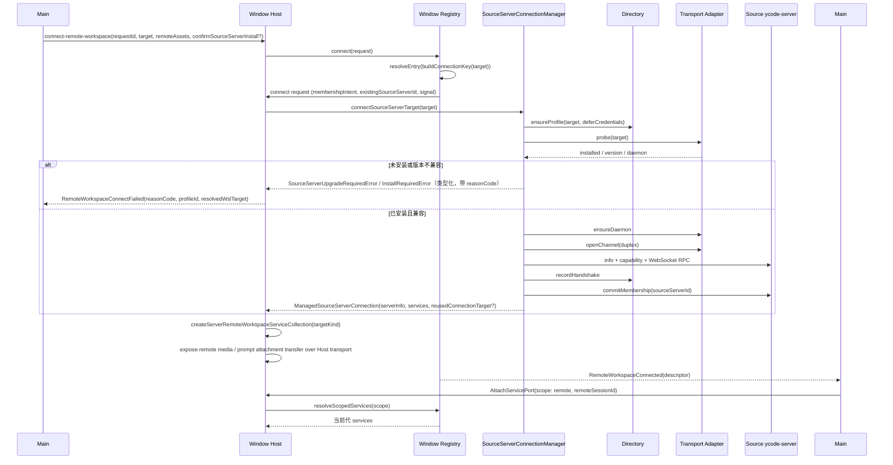
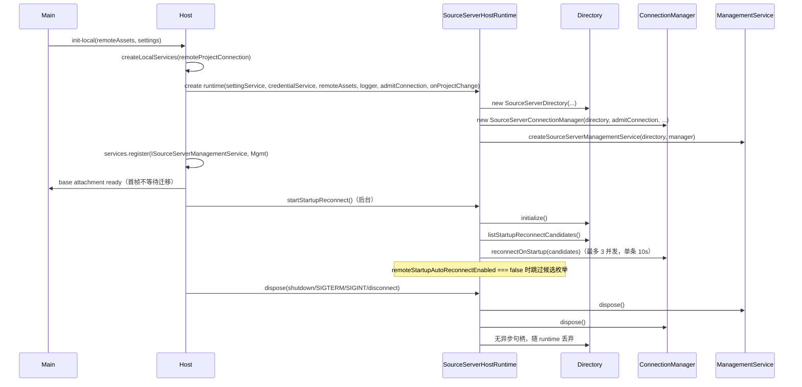
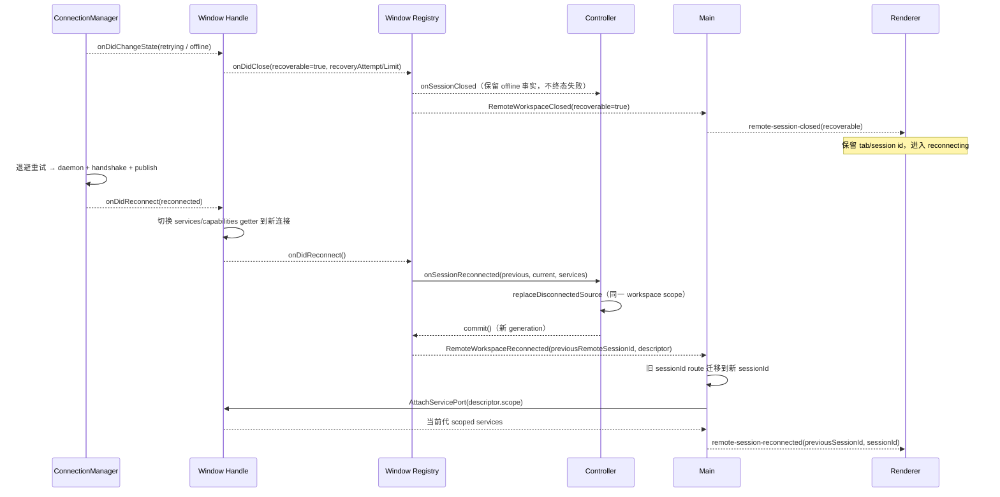

# 项目优先 / Source Server 后端基础

## 产品语义

- 目标：以「项目 → Source Server → Project」为一级导航的数据与服务基础，桌面端只持有连接目录、Profile 与远端项目缓存，不在 Controller 侧复制 Agent 任务状态。
- Source Server 是运行在远端（SSH / WSL / Docker 隧道后）的独立 Server；本机通过一条物理连接（duplex → HTTP keep-alive → WebSocket RPC）访问其 `info`、host capability 与 RPC 服务。
- 连接身份与展示路径分离：
  - `workspaceIdentity` 参与去重、绑定、缓存、队列、持久化与请求关联；统一由 `buildRemoteWorkspaceIdentity` / `buildServerRemoteWorkspaceIdentity` 构造，禁止业务层手写 authority。
  - `workspacePath` 只用于文件操作、命令 cwd、Git 与展示。
  - 身份 key 统一为 `workspaceIdentity?.trim() || workspacePath`。
- Source Server 设备级身份 `sourceServerId` 是该设备所有 Profile 与 workspace 的稳定 authority；线路级 `remoteSessionId` 只标识一次 attachment，绝不能替代设备身份。
- 本切片只交付 typed 后端服务/端口；不构建项目侧栏与设置页 UI。

## 所有者（唯一写入方）

| 领域                              | 所有者                                              | 职责                                                                                                               |
| --------------------------------- | --------------------------------------------------- | ------------------------------------------------------------------------------------------------------------------ |
| Profile / Source / workspace 历史 | `SourceServerDirectory`（desktop host，单窗口实例） | 持久化 `AppSettings.connectionProfiles/sourceServers/sourceServerWorkspaceHistory`，串行写队列，产生 `onDidChange` |
| 物理连接状态机                    | `SourceServerConnectionManager`（desktop host）     | probe → install/upgrade → daemon → handshake → publish；单 profile 单 flight 归并、重试与自动恢复                  |
| 连接/更新管理面                   | `createSourceServerManagementService`               | 对 UI 暴露快照、连接、更新、重命名、删除、迁移统计与操作日志；不直接持有网络                                       |
| 安装包解析                        | `resolveSourceServerReleaseAsset`（desktop host）   | 版本化 / 开发内容寻址 release descriptor、CDN 与本地缓存；校验 SHA-256 与大小                                      |
| 远端项目目录                      | `project-catalog` + `project-storage`               | `readProjectCatalog` 汇总本机与在线 Host；`ProjectRepository` 读写 `projects/project_roots/remote_project_entries` |
| 远端传输                          | `@ycode/server/source-server`                       | `probe`、`installOrUpdate`、`ensureDaemon`、`openChannel`、`exec`；不持有桌面连接状态                              |
| RPC 服务访问                      | `RemoteServiceAccess`（client）                     | 通过 ChannelClient 代理 `projectService`、`sourceServerWorkspaceService` 等                                        |

不得出现第二条写入路径：UI 不直接调用 Directory/Manager，必须经管理服务；Manager 只向 Directory 提交握手事实。

## 连接生命周期

```mermaid
stateDiagram-v2
  [*] --> absent
  absent --> bootstrapping: connect(profile,target)
  bootstrapping --> needs-install: probe.installed=false
  bootstrapping --> needs-upgrade: 版本不满足最低兼容
  bootstrapping --> updating: updateServer()
  needs-install --> bootstrapping: installOrUpdate(allowInstall)
  needs-upgrade --> updating: updateServer(force?)
  updating --> bootstrapping: 安装完成
  bootstrapping --> online: daemon + handshake + publish
  bootstrapping --> identity-change-pending: recordHandshake 返回 identityChanged
  identity-change-pending --> bootstrapping: confirmIdentityChange
  bootstrapping --> retrying: 可恢复错误
  retrying --> bootstrapping: 退避重试（预算内）
  retrying --> failed: 预算耗尽 / 不可恢复
  online --> offline: 显式 disconnect / 意外关闭
  offline --> bootstrapping: 手动或启动批次重连
  failed --> [*]
```

事件顺序（成功路径）：

1. `admitConnection`（若注入）在读取/提交凭据前完成 admission。
2. `probe(target)` 读取平台、架构、已安装版本与 daemon 状态。
3. 未安装且允许安装时 `resolveRelease` → `installOrUpdate`；版本不兼容进入 `needs-upgrade`，连接流程本身不安装。
4. `ensureDaemon` 返回 `{ port, ingressToken }`。
5. `connectServer` 复用同一条 duplex 完成 `info` / capability / WebSocket upgrade；`serverInfo.compatibility` 缺失或不兼容时进入 `needs-upgrade`。
6. `directory.recordHandshake` 落盘 Source/Profile/history；身份变化未确认时进入 `identity-change-pending`。
7. `commitMembership` 成功后才发布 online；发布前的 close 事件只记录事实，不发布已死连接。
8. 自动恢复只由 `isSourceServerAutomaticRecoveryTerminalState` 判定终态；`retrying/offline` 生成可恢复 close 事件。

## 身份与边界

- **local vs remote Host**：每个窗口一个 window-scoped Local Host；Source Server 连接沿用同一窗口的 remote attachment 机制，不另起 Agent、Local Host 或远程会话。
- **desktop-continuous vs web-remote-replayable**：本切片的 source-server 状态机只服务桌面连续链路（单 duplex + 实时 RPC）。手机 `web-remote-replayable` 的 snapshot/queue/重连语义不在本切片内，接线时不得把两者的恢复策略混用；Source 自动重连只驱动桌面 attachment 的 `.generation` 换代。
- **owner/lease**：`sourceServerId` 是设备级 owner 标识；`profileIds` 记录共享同一物理连接的多个 Profile。断开只作用于该 `sourceServerId` 对应的在线 owner，迟到 close 不得拆除 sibling。窗口 registry 的 handle 只是 logical/attachment lease：`dispose()` 只释放订阅，不调用 Manager 断开共享 Source。
- **远端 workspace**：SSH/WSL/Docker 的窗口连接已整体切到 `SourceServerConnectionManager`，不再调用 `setupRemoteConnection`；不存在静默回落旧链路的路径。
- **直连 URL（kind=server）**：已并入 `RemoteTarget` / `RemoteTargetSnapshot`。直连目标不安装 Source Server，直接对已运行 server 完成 `info` / host capability / WebSocket 握手；成员 admission 与 SSH/WSL/Docker 共用 `prepareRemoteServerConnection`。窗口 registry 以 `serverId || 规范化 endpoint` 复用物理连接，握手后把 logical workspace identity 收敛到 `remote:server:<sourceServerId>:<path>`，`remoteSessionId` 仍只标识一次 attachment。

### 窗口连接顺序（ssh / wsl / docker）



- `confirmSourceServerInstall` 只影响 Manager 的 `allowInstall`；缺省沿用窗口连接既有部署语义（首次连接允许安装）。管理面的显式升级/身份确认仍走 `connectProfile` / `confirmIdentityChange`。
- 同一 `buildConnectionKey` 上的多个 logical session 共享一个 handle；`reusedConnectionTarget` 只来自 Manager 的脱敏实际线路，Registry 再次 `stripRemoteTargetSecrets` 后交给 Main/Renderer，本轮输入凭据不参与认证也不落库。

## Host 接线（本切片）

每个窗口的 Local Host 持有唯一一组 Source Server 运行时：

| 组件                                  | 实例化位置                                                | 依赖                                                                                                                                                                                                                                                                            |
| ------------------------------------- | --------------------------------------------------------- | ------------------------------------------------------------------------------------------------------------------------------------------------------------------------------------------------------------------------------------------------------------------------------- |
| `SourceServerDirectory`               | `sourceServerHostRuntime`（desktop host，每个 Host 一份） | `ISettingService`、`ICredentialService`；持久化在 `AppSettings.sourceServers/connectionProfiles/sourceServerWorkspaceHistory`，无独立数据目录                                                                                                                                   |
| `SourceServerConnectionManager`       | 同一 runtime                                              | Directory、`connectDesktopSourceServer`、`resolveSourceServerReleaseAsset`；`remoteAssets` 来自 InitLocal（`remoteCacheDir/mockCdnDir/remoteCdnBaseUrl(s)/sourceServerArtifactPolicy`）；`admitConnection` 来自 `createRemoteProjectConnectionAdmission(IRemoteProjectService)` |
| `createSourceServerManagementService` | 同一 runtime                                              | Directory + Manager；注册为 `ISourceServerManagementService` channel                                                                                                                                                                                                            |
| `projectStorage`                      | `@ycode/services/node` 导出                               | 迁移契约；Host 启动经 `TaskIndexRepo` 执行幂等项目迁移，失败中止启动并暴露报告                                                                                                                                                                                                  |
| `projectCatalog`                      | `@ycode/services` 导出纯函数                              | 需要 `projectService`/`remoteProjectService` 端口；两者已在本切片注册                                                                                                                                                                                                           |

RPC 面（`source-server-management` channel）提供：`getSnapshot`、`getRecentOperationLogs`、`addProfile`、`connectProfile`、`confirmIdentityChange`、`disconnectSource`、`updateSource`、`renameSource/Profile`、`updateProfile`、`setPreferredProfile`、`removeProfile`、`removeSourceServer`、`getMigrationReport`、`exportMigrationReport`、`abandon/retryWorkspaceMigration`、`ensureConversationWorkspace`。其中 add 走 `connectSourceServerTarget`（Directory 负责 Profile/凭据，Manager 负责连接归属），不会产生第二条 Profile 写入路径。

### 启动 / 重启 / 关闭顺序



- 启动重连失败只记录 `profileId + error`，本地 Host 继续可用；Directory 初始化失败不会被缓存为 rejected flight，用户显式操作仍可重试。
- 每个窗口只有一组 Directory/Manager；物理 Source 连接由 Manager 持有，窗口 registry 的 logical workspace attachment 只引用它，不另建 Source owner。直连 `kind=server` 由 registry 直接持有单条 URL 连接，不经过 Manager。
- Renderer 的本地 base attachment 显式开启 `sourceServerManagementService`；remote session port 不开启，避免把管理频道代理到远端 Source Host。
- 受管 Source 的服务集合对桌面 `desktop-continuous` 完全以目标 Environment 为准；仅当 Host 注入 `sourceServices` 时额外发布 `IWindow*ProjectService`，供手机 `web-remote-replayable` 使用窗口 owner 的项目目录，两种语义不互相覆盖。
- `desktop-continuous` 的实时 RPC 与 `web-remote-replayable` 的 snapshot/queue 重连属于 attachment 层；本 runtime 不向手机路径发布 Source 快照。

### 自动重连与 attachment 换代



- 只有终态 close（不可恢复、恢复预算耗尽或 Profile 被删除）才收口 logical session；可恢复 close 只释放失效 attachment，tab 保留到换代事件。
- `workspaceIdentity` 在新 generation 中保持不变，`remoteSessionId` 由 Main/Registry 一起换代；sibling workspace 的替换失败不会回滚已提交的 generation。
- 自动重连只作用于 `desktop-continuous`；`web-remote-replayable` 仍由手机侧 attachment 自己恢复，不复用本序列。

## 迁移安全

- `project-storage` 使用 `@ycode/shared/sqlite-migrations`：
  - 迁移 SQL 是 checksum 输入，发布后不可修改；`apply` 只用于数据回填。
  - 迁移前按可写卷优先级备份相关表；空间不足时记录 `onBackupSkipped` 诊断，不中断用户数据。
  - 只做 `CREATE TABLE IF NOT EXISTS` / `ALTER TABLE ADD COLUMN` 与新增索引，禁止重命名、删除列或重写用户数据。
  - 同一迁移可重复执行：`projects` 以 `(host_id,name) WHERE deleted=0` 唯一，workspace 历史按 canonical identity 去重。
- `SourceServerDirectory`：
  - `sourceServerDirectoryMigrationVersion === 1` 时跳过旧 remote entry 迁移；迁移按精确 route 幂等审计，不根据 alias/hostname 猜测凭据。
  - 身份变化只把历史 key 重定向到 canonical `remote:server:<id>:<path>`，并逐条交给 `migrateControllerIdentity`；失败项进入 `migrationFailures`，不静默丢弃。
  - 本切片未接入 Controller tasks DB 的 identity 迁移实现，默认返回显式 `failed` 报告并暴露到管理快照（失败可见，不伪造成功）。
- Source Server 侧数据库迁移（`source-server-schema-v5`）与 `project-storage` 分库；本切片不修改既有 tasks DB schema。

## 验收

1. `packages/shared/src/source-server/*` 导出连接 Profile、状态快照、管理快照、release descriptor、错误码与兼容性判定；`server-remote` 增加可选 `compatibility/migration/identity/virtualProjects`，旧客户端可忽略。
2. `packages/server/src/source-server/*` 提供 `probe`、`installOrUpdate`、`ensureDaemon`、`openChannel`、`exec` 适配器；`@ycode/server` 暴露 `./source-server` 子路径。
3. `project-storage` 迁移在空库与已有 tasks 库上均可运行，重复执行不产生重复项目；`project-catalog` 只读汇总在线 Host，不为查询启动 Agent。
4. `SourceServerDirectory` 对同一 transport 身份幂等复用 Profile；`SourceServerConnectionManager` 成功发布 online，显式 disconnect 回到 offline，发布前 close 不产生幽灵在线连接。
5. `resolveSourceServerReleaseAsset` 在开发内容寻址策略下只消费本轮本地 descriptor/archive，并校验 SHA-256 与大小。
6. 校验通过：`pnpm exec tsc -b packages/rpc packages/shared packages/services packages/client packages/server packages/desktop/tsconfig.host.json`、`node scripts/typecheck-desktop.mjs`、目标文件 `oxlint`、`pnpm architecture:check --changed`、`git diff --check`。
7. 聚焦测试通过：`packages/services/test/projectStorageMigration.test.ts`、`packages/desktop/test/sourceServerDirectory.test.ts`、`packages/desktop/test/sourceServerConnectionManager.test.ts`（含 ssh/wsl/docker 与复用目标）、`packages/desktop/test/connectSourceServerTarget.test.ts`（凭据提交与复用）、`packages/desktop/test/windowRemoteConnectionRegistry.test.ts`（Source 重连换代与复用目标投影）、`packages/desktop/test/remoteWorkspaceServiceCollection.test.ts`（四种 targetKind 共用集合）、`packages/desktop/test/sourceServerReleaseResolver.test.ts`、`packages/desktop/test/sourceServerHostRuntime.test.ts`。

## 未交付（显式 gap）

- 已接入 `packages/desktop/src/host/index.ts`：Directory/Manager/Management 实例化、`admitConnection`/`onProjectChange` 注入、注册 `ISourceServerManagementService`、启动静默重连与关闭回收；尚无项目侧栏/设置页等 UI 入口。
- 未移植 bots / `windowTopicResourceRelay`：本地无 `IBotsService` 与 topic-resource 协议；`connectDesktopSourceServer` 仅建立/释放物理连接。
- `project` 与 `remote-projects` 的完整服务实现已在本切片补入，详见 `specs/project/project-service-layer.md`；Source membership、`connectHost` 连接器与直连 `kind=server` target 均已接入 Host。
- 已接入 Host 启动项目迁移：`TaskIndexRepo` 在任务 schema 后就绪执行幂等 `projectStorage.migrate`，携带旧 settings 与 `hostId`；失败中止启动并通过 `getProjectMigrationReport()` 暴露。`controllerRemoteIdentityMigration`、`source-server-workspace` 的远端实现与 `source-server-schema-v5` 写入路径仍不在本切片。
- 窗口连接（SSH/WSL/Docker）与直连 `kind=server` 都已接入 `windowRemoteConnectionRegistry`：`connectSource`、`entriesBySourceServerId`、握手后的稳定 identity、Manager 自动重连换代与 `RemoteWorkspaceReconnected` 重挂载均已实现；`setupRemoteConnection` 已从窗口路径删除，不存在旧链路回落。
- 未新增项目侧栏、设置页设备卡、迁移报告 UI；`removeSourceServer` 会删除对应设备级远端项目 host（只删本机入口，不调用远端删除）。
- UI 仍按 SSH/WSL/Docker 穷尽 `RemoteTarget`/`RemoteTargetSnapshot` switch；直连 `server` 的图标、展示名、校验与日志标签留待 UI 切片，后端不伪造 UI 行为。
