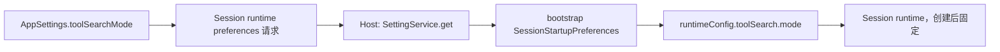

# ToolSearch 模式设置规范

## 1. 产品规则

- 设置项 `toolSearchMode` 的取值为 `"auto" | "native" | "local" | "off"`，默认 `"off"`。
- `off`：向模型发送全部工具定义，上下文占用最高，不产生额外搜索调用。
- `local`：延迟工具按需检索，减少上下文占用，但模型可能多一次 `ToolSearch` 调用。
- `native`：仅对支持 advanced-tool-use 协议的 Anthropic 兼容模型启用；由服务端延迟
  加载工具定义。其他模型显式选择 `native` 会在发送前失败，不静默降级。
- `auto`：Anthropic 兼容模型按 `native` 运行，其他支持普通工具调用的模型按 `local`
  运行，否则保持 `off`。
- 设置只影响**新建或恢复的会话**。会话在 create/resume（含冷恢复）时读取一次并固定；
  修改设置不得改写已经运行的会话。
- CLI `--toolsearch-mode` 保持为单次运行的独立覆盖，不读取也不回写本设置。
- Desktop、Web、本地 Host、desktop-attached remote 均使用同一个 App 设置值；不做厂商或
  账号门控。

## 2. 状态所有者

- **SettingService / AppSettings**：唯一持久化事实与默认值来源。
- **Session runtime preferences**：create/resume 时从 Host 读取，属于会话启动快照。
- **Runtime config**：唯一模式来源；子 Agent 继承父配置。
- **运行中会话**：不订阅设置广播，不热更新 `toolSearch`。

## 3. 接口

- `appToolSearchModeSchema = z.enum(["auto", "native", "local", "off"])`。
- `AppSettings.toolSearchMode?: AppToolSearchMode`：完整 schema 默认 `"off"`，patch schema
  可选；缺省字段按 `"off"` 读取，兼容旧 settings。
- `appRuntimePreferencesChangedBroadcastPayloadSchema.toolSearchMode`：默认 `"off"`，
  用于跨窗口刷新；接收窗口只 refresh + sync，不再次广播，避免回环。
- `ycodeSessionRuntimePreferencesResultSchema.toolSearchMode`：默认 `"off"`，兼容旧 Host。
- `SessionStartupPreferences.toolSearchMode` → `runtimeConfig.toolSearch.mode`。
- `YCodeProtocolSessionRecord.toolSearchMode`：供子 Agent / inherit 路径继承会话固定值。

## 4. 验收场景

1. 空 settings 解析出 `toolSearchMode === "off"`；显式 `auto` / `native` / `local` / `off`
   原样保留；非法值被拒绝。
2. patch 不含字段时不产生该字段；包含时通过校验。
3. 设置页在中文/英文下展示关闭、本地、原生、自动四个选项及成本/行为说明。
4. 本地、Web、远程 Host 的 runtime preferences 响应都携带当前设置值。
5. 新建会话、恢复会话和冷恢复写入相同的 `runtimeConfig.toolSearch.mode`。
6. 会话运行中修改设置，不改变已有会话；下一个新会话或恢复会话使用新值。
7. CLI `--toolsearch-mode` 仍可独立覆盖本次运行。
