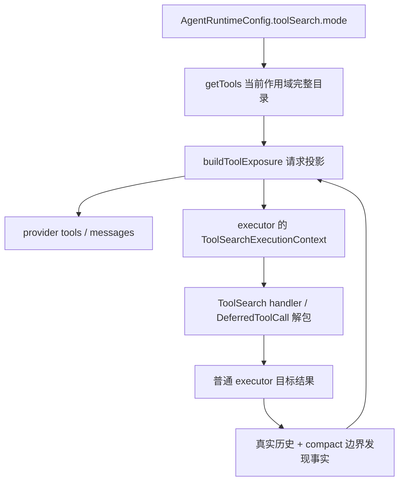

# ToolSearch Local 模式规范

## 1. 范围与目标

本规范描述 ToolSearch 的 **Local 模式**垂直切片及其 App 启用方式。Native 协议
（Anthropic `defer_loading` / `tool_reference` / beta header）见
`specs/tools/tool-search-native.md`；两种模式共用延迟目录与历史事实。

目标：

- 内置注册 `ToolSearch` 与 `DeferredToolCall`，但默认模式为 `off`；
- 常驻工具照常发送完整 schema；声明延迟的工具只公告名称，搜索后才返回完整定义；
- 搜索完全在本地目录完成，不依赖供应商能力、账号或灰度；
- 延迟工具通过 `DeferredToolCall` 包装执行，复用普通 executor 的调度、校验、权限、
  Hook、超时、取消、结果格式与 turn-stop；
- 历史、请求投影和冷恢复保持同一事实：内部保存目标身份，模型侧还原包装调用。

启用方式：

- **CLI**：`--toolsearch-mode auto|native|local|off`；Local 规范只定义
  `auto|local|off` 的行为，Native 见对应规范；
- **宿主注入**：通过 `AgentRuntimeConfig.toolSearch.mode` 写入 `"local"` / `"auto"`；
- **App Settings**：设置页「工具搜索」写入 `AppSettings.toolSearchMode`，Desktop / Web /
  本地 / 远程会话在 create/resume（含冷恢复）时读取一次，转换为
  `runtimeConfig.toolSearch.mode`；运行中的会话不被改写。详见
  `specs/settings/tool-search-mode.md`。

缺省 `off`；Local 侧 `auto` 在模型支持普通工具调用时解析为 `local`，否则保持 `off`
（Anthropic 模型由 Native 规范优先解析为 `native`）。

## 2. 契约

### 2.1 工具与模式

| 项       | 值                                                                                  |
| -------- | ----------------------------------------------------------------------------------- |
| 控制工具 | `ToolSearch`、`DeferredToolCall`                                                    |
| 模式     | `auto` \| `native` \| `local` \| `off`，运行时只解析为 `native` \| `local` \| `off` |
| 默认     | `off`                                                                               |
| 搜索输入 | `{ query: string, max_results?: number }`，模型侧两者均为 required，默认 5          |
| 搜索输出 | `{ matches: string[], query: string, total_deferred_tools: number }`                |
| 包装输入 | `{ name: string, input: object }`（strict）                                         |
| 搜索权限 | `tool.search`，只读、低风险、无外部副作用                                           |
| 包装权限 | 控制入口本身不执行；解包后使用目标工具的权限、Hook 与审批                           |

### 2.2 新增字段

- `ToolMetadata.shouldDefer?: boolean`：声明该内置工具默认延迟。
- `ToolMetadata.alwaysLoad?: boolean`：覆盖延迟声明，始终发送完整 schema。
- `ToolMetadata.searchHint?: string`：仅供检索的额外语料，不改变 provider description。
- `ModelToolContract.deferLoading?: boolean`：Native 契约字段。Native 请求按该字段
  发送 `defer_loading`；Local 请求投影会剥离该字段，不向 provider 发送。
- `ToolExecutionContext.toolSearch?: ToolSearchExecutionContext`：当前请求的目录、
  发现集合与模式；由请求准备产出，执行链只读复用。
- `ModelInputMessage.modelCallWrapper?: "DeferredToolCall"`：内部历史包装标记。
- `ToolPart.metadata.modelCallWrapper`、`ToolPart.state.metadata.modelContent`：持久化
  标记与 ToolSearch 真实引用。

`ToolSearchExecutionContext`：

```ts
{
  mode: "local" | "off";
  enabled: boolean;
  catalog: ToolSearchCandidate[]; // 当前请求允许的完整候选目录
  discovered: ReadonlySet<string>; // 历史中已成功加载的工具名
}
```

## 3. 状态所有者



- **Registry**：保存完整工具与 `ToolMetadata`，不保存请求级可见性。
- **Runtime config**：唯一模式来源；子 Agent 继承父配置，能力校验按 child 实际模型重算。
- **请求准备**：唯一决定本次请求暴露哪些 schema、如何展开历史引用。
- **Executor**：唯一解包并执行 `DeferredToolCall` 的边界；Render/UI 不修改内部身份。
- **历史**：保存目标工具名、目标参数与 `modelCallWrapper` 标记；不保存 Local 展开后的
  schema 文本，也不保存第二份包装 input。

## 4. 延迟判定与暴露算法

### 4.1 延迟集合

工具进入 deferred 集合同时满足：

- 不是 `ToolSearch` / `DeferredToolCall`；
- 不是 provider 原生工具；
- `metadata.alwaysLoad !== true`；
- `metadata.shouldDefer === true` 或存在 `mcpPresentation`（MCP 默认延迟）。

### 4.2 目录与启用

```text
requested = mode === off ? off
          : mode === native ? (protocolSupported ? native : error)
          : mode === local ? (supportsToolCall ? local : error)
          : (protocolSupported ? native : supportsToolCall ? local : off)
catalog = 当前作用域允许的全部 ModelToolContract（含控制工具）
deferred = 配置为 deferred 且未被 compact 边界提升的工具名
enabled = requested !== off && 存在配置延迟工具 && 控制工具都在 catalog
mode = enabled ? requested : off
```

没有 deferred 工具或控制工具被 allowlist/权限隐藏时，搜索关闭并记录原因
（`provider_disabled` / `no_deferred_tools` / `tool_unavailable`）。Explore 的 direct 与
embedded 两套白名单都包含控制工具，保留原有目标工具范围；其他自定义 scope 缺少控制
工具时仍按同一规则关闭搜索。

### 4.3 Provider 可见工具

- `off`：全量工具；不发送 `ToolSearch` / `DeferredToolCall`。
- `local`：发送常驻工具、`ToolSearch`、`DeferredToolCall`；deferred 工具不进入
  provider `tools`，即使历史已加载也不重复发送 schema。
- `native`：发送常驻工具、`ToolSearch` 与全部 deferred 工具，deferred 工具带
  `defer_loading: true`；不发送 `DeferredToolCall`。详见 Native 规范。
- `ToolSearch` 描述在 Local 模式下使用带 `DeferredToolCall` 调用的固定文案。
- Local 请求工具列表剥离 `deferLoading`。

### 4.4 历史引用投影

成功 `ToolSearch` 结果在历史中保存严格引用：

```json
[
  { "type": "text", "text": "found" },
  { "type": "tool_reference", "toolName": "Agent" }
]
```

Local 请求投影按结果内连续引用展开：

```text
<functions>
<function>{"description":"…","name":"Agent","parameters":{…}}</function>
</functions>
```

- 不跨结果或中间文本合并，不输出空容器；
- 定义编码仅在单次请求内按工具对象复用，下一请求重新读取当前 schema；
- 未变化的历史 entry/message/content 复用原引用，只有移除/展开时才复制；
- 成功加载的 deferred 工具追加 inline reminder，提示用 `DeferredToolCall` 调用；
- 已加载过的工具再次搜索追加“定义已可用”提醒，不重复提醒首次调用；
- `off` 模式删除引用块，空结果替换为 `[Tool references removed - tool search not enabled]`。

## 5. 搜索语义

- `select:A,B`：按名称/alias/MCP 可读名精确选择；直接选择不截断，可命中常驻工具。
- 精确名称：区分 deferred 优先，同时允许常驻工具。
- `mcp__server__tool` 前缀：按前缀返回 deferred MCP 工具。
- 关键词：仅搜索 deferred 工具，匹配名称分词、description、searchHint；别名用于 `select:`
  的精确选择，不参与关键词分词。
- `+term`：要求名称或语料包含该词，其他关键词参与排序。
- 排序稳定，按分词命中、MCP 名称、hint、description 加权，`max_results` 截断关键词结果。

内置高 Token 工具的最小延迟集合：`Agent`、Cron 四件套、`escalate`、动态工作流
创建/修订/保存/清单/快照/run 内省/恢复/问答、`EnterPlanMode` / `ExitPlanMode`、
`ListModels`、`WebSearch`。其余工具不被本切片改动。

## 6. DeferredToolCall 执行

严格输入 `{ name, input }`，共用外层 callID。准入与执行共用同一解包函数：

```text
原始包装调用
  -> resolveDeferredToolCall（streaming admission 与 executor 同一实现）
  -> 同 callID 的目标调用 + modelCallWrapper: "DeferredToolCall"
  -> 普通 schedule / 校验 / 权限 / Hook / timeout / cancellation / turn-stop
```

规则：

- 只接受当前请求 `catalog` 中存在且 `deferred: true` 的 client-executed 工具；
- 常驻、`alwaysLoad`、控制工具、provider 原生工具一律拒绝，并提示直接调用；
- 未搜索不是执行禁令：模型直接调用已加载或未加载的目标工具仍走普通错误/校验链；
- 目标入参在执行入口独立复制，Hook/审批/handler 不得改写历史中的原始目标参数；
- 准入失败保持包装身份，只产生包装失败结果，不触发目标生命周期；
- 不递归运行第二套 executor。

## 7. 持久化、冷恢复与投影

- tool part 的 `tool` 保存目标名称，`metadata.modelCallWrapper` 保存严格字面量；
- `state.input` 保存目标内层参数，不重复保存包装 input；
- 成功 ToolSearch 的 `state.metadata.modelContent` 保存真实 `tool_reference` 引用；
- 冷恢复：从 part metadata 恢复标记，从 `modelContent` 恢复引用，再构造 target + marker；
- Provider 请求投影：assistant `toolCalls` 还原为 `DeferredToolCall({ name, input })`，
  tool result 的 `toolName` 还原为 `DeferredToolCall`，并删除内部标记；
- Tool 名称、Todo 判断、事件与后台任务继续使用内部目标身份。

## 8. Compact 与公告

- 正常轮次的公告由 `buildToolSearchAnnouncement` 基于当前目录与历史增量事实生成，
  提交到 turn request history；同一目录不重复公告。
- Compact 边界只保存 `preCompactDiscoveredTools` 名称集合，不复制 schema；冷恢复时
  该元数据回填到摘要后的首个 user entry，Local 继续把发现的工具视为常驻。
- Compact 历史中的引用仍按名称/文本参与投影；本切片不修改 compact-active 的模型候选
  策略与摘要执行循环。
- 公告只在内存/请求历史中提交，不新增 session 持久化；冷恢复后会按当前目录重新公告
  一次。后续完整切片如需跨重启去重，应增加公告持久化与 hydration 解析。

## 9. Capability 与边界

- `resolveToolSearchCapability` 按模型 API 类型返回
  `protocolSupported = apiType === "anthropic-messages"`，且
  `defaultEnabled = protocolSupported`；不做 vendor/account 灰度。
- Local 是否启用由 `AgentRuntimeConfig.toolSearch.mode` 与模型
  `supportsToolCall` 决定；Native 由协议能力决定，见 Native 规范。
- MCP 初始化、异步就绪、鉴权、权限与工具面筛选保持原状；本切片不新增等待或搜索阻塞。
- Desktop continuous 与手机 replayable 的 stream/snapshot/queue 语义不变；只改变请求
  投影与工具身份持久化。

## 10. 验收

已执行：

- `pnpm --filter @ycode/contracts typecheck`
- `pnpm --filter @ycode/core typecheck`
- `pnpm --filter @ycode/adapters typecheck`
- `pnpm typecheck`（根）
- 临时 tsx 用例覆盖：`select:`、关键词、`+required`、暴露过滤、`<functions>` 展开、
  常驻工具拒绝包装、目标解包、Provider 包装还原、公告名称；执行后删除临时文件。

验收场景（后续测试固化）：

1. `off`：发送全量工具，不出现控制工具、引用展开或包装调用。
2. Local 首轮：只发送常驻工具 + 控制工具；公告包含全部 deferred 名称。
3. `select:Agent`：结果展开 Agent schema；下一请求仍不把 Agent 放进 tools。
4. `DeferredToolCall({name:"Agent"})`：以同一 callID 执行 Agent，权限/审批/结果与
   直接调用一致；冷恢复后模型侧仍是包装调用。
5. 常驻/控制/原生工具被包装：返回可恢复业务错误，不执行目标。
6. compact 后有发现检查点：原 deferred 工具提升为常驻；未提升工具仍需重新搜索。
7. 历史引用在 `off/local` 切换下按规范移除或展开，call/result 配对保持完整。
8. 子 Agent 继承父模式；不支持的模型在显式 `local` 下发送前报错。

## 11. 已知限制与风险

- App Settings 暴露 `auto|native|local|off`，默认 `off`；Native 仅对 Anthropic 兼容
  模型生效，其他模型显式选择会在发送前失败。设置仍在会话 create/resume 时固定。
- `--toolsearch-mode` 接受 `auto|native|local|off`；Native 行为见对应规范。
- 公告未持久化，冷恢复会重新公告一次。
- `compact-active` 的 compact 模型请求仍使用完整 `getTools` 目录；Local 下会携带未
  加载工具 schema，属于后续切片需要统一的暴露边界。
- 未运行 Desktop/手机真实 E2E、Windows/Linux PTY 或真实供应商缓存验证；本切片仅以
  类型检查、Lint、架构检查和临时本地用例验证。
