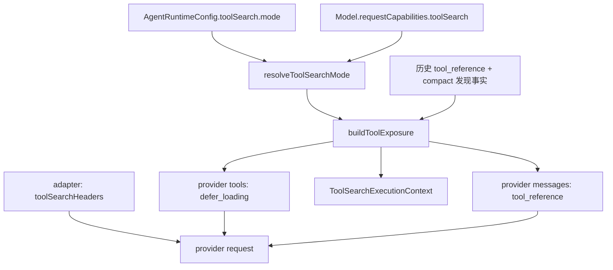

# ToolSearch Native 模式规范

## 1. 范围与目标

本规范描述 ToolSearch 的 **Native 模式**：使用 Anthropic Messages 的 advanced-tool-use
协议，让服务端延迟加载工具定义。Local 模式继续保持
`specs/tools/tool-search-local.md` 描述的语义，二者共用同一套延迟目录与历史事实。

目标：

- 模式取值为 `auto | native | local | off`，运行时解析为 `native | local | off`；
- 只有 Anthropic Messages 兼容模型支持 Native；其他模型显式选择 `native` 必须在
  发送前失败，不能静默降级为 Local；
- Native 请求发送 beta header `advanced-tool-use-2025-11-20`；对已发现的 deferred 工具
  发送 `defer_loading: true`，未被发现（历史中无成功引用）的 deferred 工具只公告名称；
- 成功 `ToolSearch` 结果中的 `tool_reference` 原样投影为 Anthropic tool-reference
  内容块，由服务端展开工具定义；
- Native 下不发送 `DeferredToolCall`，也不把目标调用包装为 `DeferredToolCall`；
- 不做 vendor/account 灰度：协议能力只由模型 API 类型决定；
- 不改变 Local、历史与 UI 行为；compact 摘要请求复用当前模式的同一暴露决策（见 §5）。

## 2. 模式解析

能力事实：

```ts
toolSearch = {
  protocolSupported: apiType === "anthropic-messages",
  defaultEnabled: protocolSupported,
};
```

解析规则：

```text
off    -> off
native -> protocolSupported ? native : 发送前抛错
        错误：--toolsearch-mode native requires an Anthropic Messages provider.
auto   -> protocolSupported && defaultEnabled ? native
        : supportsToolCall ? local
        : off
local  -> supportsToolCall ? local : 发送前抛错
        错误：--toolsearch-mode local requires a provider that supports tool calls.
```

- `auto` 在 Anthropic Messages 上选择 `native`，在其他支持普通工具调用的模型上选择
  `local`，其余保持 `off`。
- 显式 `native` 的拒绝发生在请求准备阶段，不产生 provider 请求。
- 解析结果写入 `ToolSearchExecutionContext.mode`；请求级 `toolSearchEnabled` 仅在
  `mode === "native"` 时为 `true`。

## 3. Wire 契约

### 3.1 Beta header

Native 请求在现有 `anthropic-beta` 头后追加
`advanced-tool-use-2025-11-20`，保留原有值并按逗号去重：

```http
anthropic-beta: existing-beta,advanced-tool-use-2025-11-20
```

头名大小写不敏感；不存在时使用 `anthropic-beta`。未启用 Native 时不添加该头。

### 3.2 工具定义

- 常驻工具：完整 schema，无 `defer_loading`。
- 已发现的 deferred 工具（历史中存在有效 `tool_reference`）：保留名称、description、
  input schema，附加 `defer_loading: true`。
- 未发现的 deferred 工具：不进入 provider `tools`，只通过公告与 `ToolSearch` 目录暴露；
  首次搜索结果产生引用后，下一请求再按已发现工具发送。
- `ToolSearch` 始终作为常驻控制工具发送，description 使用 Native 文案。
- Native 不发送 `DeferredToolCall`。

Anthropic 请求中的工具项形如：

```json
{
  "name": "mcp__server__tool",
  "description": "…",
  "input_schema": { "type": "object", "properties": {} },
  "defer_loading": true
}
```

### 3.3 ToolSearch 结果

成功搜索结果在历史中保存严格引用：

```json
[
  { "type": "text", "text": "found" },
  { "type": "tool_reference", "toolName": "Agent" }
]
```

Native 请求把引用投影为 Anthropic tool-reference 内容块：

```json
{
  "type": "tool_result",
  "tool_use_id": "toolu_…",
  "content": [
    { "type": "text", "text": "found" },
    {
      "type": "custom",
      "provider_options": {
        "anthropic": { "type": "tool-reference", "toolName": "Agent" }
      }
    }
  ]
}
```

- 只有 `providerKind === "anthropic"` 且 `toolSearchEnabled === true` 时使用上述投影。
- 媒体降级（`stripMedia`）与结构化文本化不得把 `tool_reference` 变成名称文本。
- 没有 ToolSearch 上下文的辅助请求（例如投机压缩、记忆/检索等）继续把引用降级为
  名称文本；compact 摘要请求按 §5 复用当前模式暴露，Native 下使用上述 tool-reference
  投影。`tool_reference` 不得出现在 assistant 或 user 内容中。
- 服务端展开失败（例如引用未声明或不属于当前请求）由 provider 返回错误，按普通模型
  请求失败处理，不在客户端构造第二套定义。

## 4. 暴露算法

与 Local 共用 `buildToolExposure`，差异仅在模式解析与最终投影：

```text
catalog   = 当前作用域全量工具（Native 不含 DeferredToolCall）
deferred  = 配置为 deferred 的工具名
enabled   = requested !== off && 存在配置延迟工具 && ToolSearch 在 catalog
mode      = enabled ? requested : off
```

Provider 可见工具：

- `off`：全量工具，不发送控制工具或 `defer_loading`；
- `native`：常驻工具 + `ToolSearch` + 已发现的 deferred 工具（带 `defer_loading`）；
- `local`：按 Local 规范，仅常驻工具 + 控制工具。

公告文案按模式区分：Native 提示“schema 未加载，直接调用会失败，需先搜索”；Local
提示通过 `DeferredToolCall` 调用。

## 5. 历史、恢复与压缩

- 历史持久化格式与 Local 相同：tool part 保存目标名称，`modelContent` 保存真实
  `tool_reference`，不保存 provider 展开后的 schema 文本。
- `collectToolSearchHistory` 从成功 tool result 的 `tool_reference` 与 compact 边界
  的 `preCompactDiscoveredTools` 恢复发现集合。
- Native 校验历史引用时直接保留引用块（`mode !== "local"` 且工具仍可用），不展开为
  `<functions>`。

### 5.1 Compact 摘要请求

compact 摘要请求与当前 Turn 使用同一个 `prepareRuntimeProviderRequest` 暴露决策，
不再自行拼接 `messages`/`tools`：

- `native`：请求携带 `toolSearchEnabled: true`，因此 adapter 添加 beta header、对已发现
  deferred 工具发送 `defer_loading: true`，并把成功搜索的 `tool_reference` 投影为
  Anthropic tool-reference；未发现的 deferred 工具不进入 `tools`；
- `local`：`toolSearchEnabled` 缺失/false，控制工具按 Local 暴露，引用展开为
  `<functions>`；
- `off`：`toolSearchEnabled` 缺失/false，发送全量非控制工具，引用按 off 既有投影移除，
  不发送任何 Native 字段。

同一压缩操作内的流式失败回退、prompt-too-long 重选/截断与 outer retry 复用同一份
`compactPrompt`、`compactTools` 和 registry，模式不会在 `native`/`local`/`off` 之间
抖动。压缩摘要的历史投影仍与普通请求一致：先按暴露结果过滤/展开引用，再进入媒体预算
与摘要提示。

没有 ToolSearch 上下文的辅助调用（例如 `compact-speculative` 的 `tools: []` 请求）
不传 `toolSearchEnabled`；adapter 把 tool result 中的 `tool_reference` 降级为工具名称
文本，不会发出缺少 beta header 的 native 引用。

## 6. DeferredToolCall 边界

- Native 不暴露 `DeferredToolCall` 工具。
- 即使历史或流式输出出现 `DeferredToolCall` 调用，`resolveDeferredToolCall` 只在
  `search.mode === "local"` 时接受；Native 下返回可恢复业务错误，不执行目标。
- 目标工具调用在 Native 下保持普通调用身份，不写入 `modelCallWrapper`。

## 7. Fallback 规则

| 场景                           | 行为                                               |
| ------------------------------ | -------------------------------------------------- |
| 显式 `native` + 非 Anthropic   | 发送前抛错，不产生请求                             |
| `auto` + 非 Anthropic 工具模型 | 解析为 `local`                                     |
| `auto` + 不支持工具调用的模型  | 解析为 `off`                                       |
| 无 deferred 工具               | `enabled=false`，`mode=off`，reason 记录           |
| `ToolSearch` 被作用域隐藏      | `enabled=false`，reason=`tool_unavailable`         |
| Native 关闭但历史含引用        | 降级为名称文本（Local/compact 既有语义）           |
| compact 摘要请求               | 复用当前模式暴露；Native 携带 beta/defer/reference |
| 引用不属于当前请求             | 由 provider 拒绝，按普通模型请求失败处理           |

不存在“显式 native 静默降级 local”的路径。

## 8. 状态所有者



- **Capability**：只读事实，由 provider API 类型推导，不做账号/厂商判断。
- **Runtime config**：唯一模式来源；会话 create/resume 时固定。
- **请求准备**：唯一决定 `toolSearchEnabled`、`defer_loading` 与引用投影的边界。
- **Adapter**：只在请求选项上追加 beta header 与 provider tool 选项，不保存业务状态。

## 9. 验收

1. Anthropic Messages 显式 `native`：请求携带 `anthropic-beta:
advanced-tool-use-2025-11-20`，已发现的 deferred 工具带 `defer_loading: true`，常驻工具不带。
2. 成功 `ToolSearch` 结果在下一请求投影为 Anthropic tool-reference，历史不保存展开
   schema；请求 tools 中不出现 `DeferredToolCall`。
3. 非 Anthropic 映射显式 `native`：发送前报错
   `--toolsearch-mode native requires an Anthropic Messages provider.`。
4. `auto`：Anthropic 解析 `native`，其他支持工具调用的模型解析 `local`，不支持工具
   调用的模型解析 `off`。
5. `off/local` 行为与 `tool-search-local.md` 完全一致；Local 仍使用
   `DeferredToolCall` 包装执行。
6. compact 摘要请求与当前 Turn 模式一致：`native` 携带 beta header、已发现 deferred 的
   `defer_loading` 与 tool-reference 投影；`local` 展开引用且不带 Native 字段；`off`
   发送全量非控制工具。流式回退、prompt-too-long 与 outer retry 不切换模式。
7. 没有 ToolSearch 上下文的辅助请求不发送 Native 引用；引用降级为名称文本。
8. App Settings 默认 `off`，包含 `native` 选项；已有会话模式不被热更新。
9. CLI `--toolsearch-mode` 接受 `auto|native|local|off`。

## 10. 已知限制

- 仅验证 Anthropic Messages 协议；其他 Anthropic 兼容网关若未实现 advanced-tool-use，
  由 provider 返回错误，客户端不做额外探测。
- compact 摘要请求复用当前模式的暴露决策（§5.1）；但投机压缩仍是 `tools: []` 的辅助
  请求，引用按名称文本降级，不发送 Native 字段。
- 未运行真实供应商 E2E；以类型检查、Lint、架构检查与临时 wire 用例验证。
